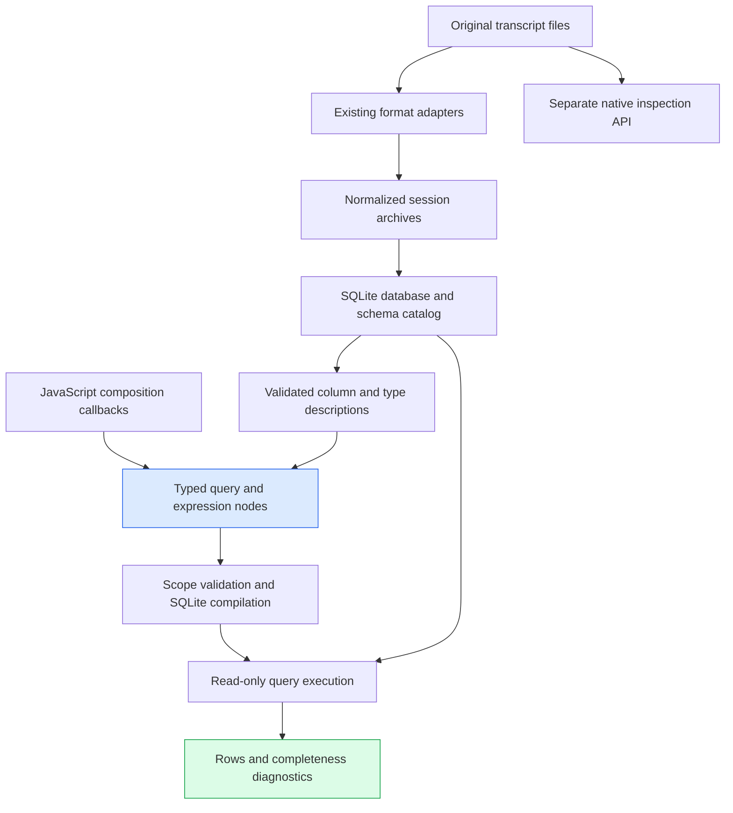

# A composable JavaScript query API and its Go implementation

## 1. Purpose and decisions

This document specifies a clean replacement for go-minitrace's public JavaScript analysis API. It is a design and implementation guide, not a claim that the examples already execute. The baseline is the implementation through commit `5b2c0d9` on `feat/evidence-fidelity`. The user explicitly requested no backward compatibility and authorized reshaping the Go implementation as well as the JavaScript surface.

The central decision is to expose a small grammar of immutable components. A query is composed from a source, predicates, projections, ordering and scalar aggregates. JavaScript functions combine those components. Named analyses are ordinary library functions, not new cases in a Go switch. Build-time callbacks construct expressions; separately declared runtime callbacks transform actual result rows. One typed representation connects this grammar to the SQL compiler and execution layer.

There will be no aliases for old names, compatibility adapters, legacy execution fallback, deprecated-method registry, or period in which documentation teaches both APIs. Implementation may proceed in commits on the feature branch, but the release boundary requires all supported in-repository callers to use the new API. Historical ticket artifacts remain unchanged because they are evidence of earlier experiments, not supported runnable examples.

The design is deliberately smaller than a general data-processing framework. The first deliverable supports normalized SQLite data and a narrow relational grammar. It does not add a distributed scheduler, a universal SQL builder, a JavaScript parser, a second JavaScript interpreter, or automatic translation of arbitrary callbacks. Fragments and runtime stages have explicit later acceptance gates; they are not prerequisites for the first useful query.

### Desired properties

- A reader can learn the core grammar once and apply it to different tables.
- A reusable analysis uses the same public operations available to its caller.
- Derived queries never mutate their parents or siblings.
- Query construction performs no data scan; execution is explicit.
- Errors identify the invalid operation, field, scope or parameter.
- Query loss remains visible, and incomplete input cannot become apparently complete output through a transformation.
- The Go model is testable without Goja; the JavaScript binding is a small translation layer.
- Serializable plans contain data and references, not hidden closures or live database pointers.

## 2. Foundations for a new contributor

A coding agent records user and assistant messages, tool calls, tool results and metadata. Claude Code, Codex and Pi use different native record formats, commonly JSONL: one JSON value per physical line. Go-minitrace adapters interpret those formats and produce normalized session archives. A normalized archive gives subsequent analysis a common vocabulary even when its original records differed.

The normalized database is SQLite, an embedded relational database. Its `sessions`, `turns` and `tool_calls` tables represent conversations, conversational turns and tool records. Session IDs connect related rows. A tool row is not necessarily a distinct successful operating-system process: records can describe orchestration or other activity. Counting rows therefore requires a clear definition of the question being answered.

Native inspection is a separate operation over original files. It preserves physical coordinates, hashes and request-reference diagnostics. A native request may refer to separately stored message blobs and shared configuration records. Missing references cannot be recovered merely by querying normalized tables. The new relational grammar does not pretend native streams and normalized tables are interchangeable.

Goja executes JavaScript inside the Go application. A module loader exposes host functions through `require("minitrace")`. Goja is not Node.js; a script must not assume Node globals exist. The CLI discovers command metadata and invokes JavaScript functions, while SQLite evaluates relational operations. The proposed expression compiler sits between the JavaScript binding and that database execution path.

A **builder** accumulates a description. In this design its methods return new builders rather than modifying the receiver. An **expression** describes a computation over symbolic columns or bound values. A **plan** is a validated description ready for execution. An **intermediate representation**, abbreviated IR, is the typed data structure used to hold those descriptions independently of their JavaScript spelling. A **directed acyclic graph**, or DAG, permits several derived nodes to share a common input without cycles. Sharing a node does not promise shared physical execution or caching.



## 3. What exists now and why it should change

`pkg/minitracejs/query_view_session.go` currently defines `QueryRecipeBuilder` with fields such as `kind`, `sessionID`, `includeTools` and `groupBy`. Methods including `ToolRows()` and `SessionToolCounts()` change `kind`. `Build()` selects SQL from a switch and packages it with arguments and descriptive metadata in `QueryRecipe`.

That interface is fluent, but its grammar is a preset selector. Chaining two preset selectors does not compose two analyses: the later selector replaces the earlier kind. Builder wrappers share mutable Go state, so retaining and branching a builder is also different from constructing independent queries. The public methods do not express arbitrary projections, predicates or reusable aggregate expressions.

`SessionToolCounts()` repaired a real analytical hazard. Queries rooted only in `tool_calls` dropped a zero-tool session while retaining the correct total number of tools. The query is useful; requiring a dedicated Go case for every useful query is the architectural issue. The replacement should express this count from reusable primitives and implement the named convenience function in the ordinary library layer.

The current module also exposes overlapping query styles, view/session helpers, convenience aliases and SQL string helpers. The clean cut removes that public duplication. The existing result correctness work remains a requirement, not a compatibility obligation: array-valued results, explicit incompleteness, read-only execution and actionable diagnostics are properties worth implementing cleanly in the replacement.

### Current source reading order

All paths below are relative to `/Users/manuel.odendahl/code/go-go-golems/go-minitrace/.worktrees/feat-evidence-fidelity`.

| Read | What to understand |
| --- | --- |
| `pkg/minitrace/schema.go` | Session, Turn and ToolCall archive entities |
| `pkg/minitracedb/schema.go`, `materialize.go`, `open.go` | SQLite columns, archive loading and materialization |
| `pkg/minitracedb/query.go` | `QueryRunner`, `QueryResult`, normalization, SQLite authorization and read-only checks |
| `pkg/minitracejs/module.go`, `default_module.go` | Goja exports and module registration |
| `pkg/minitracejs/db_builder.go` | Source/configuration accumulation, caching and database ownership |
| `pkg/minitracejs/query_view_session.go` | Current recipe switch and overlapping presentation helpers |
| `pkg/minitracejs/typescript.go` | Current declared public contract |
| `pkg/minitracejs/provider/provider.go` | Integration with host execution |
| `cmd/go-minitrace/cmds/query/command_runtime.go`, `run.go` | CLI execution, result emission and receipts |
| `pkg/nativeevidence/reader.go`, `inspect.go` | Native evidence semantics that must remain separate |

## 4. One public surface, with consistent naming

All new builder methods use lower camel case. Configuration policies are small validated values, not separate families of aliases. Source composition gets its own component because the same source selection is reused across analyses.

```javascript
const mt = require("minitrace");

const inputs = mt.sources()
  .runtimeArchives()
  .build();

const db = mt.db()
  .sources(inputs)
  .import({ autoConvert: false, strict: true })
  .cache({ mode: "memory" })
  .limits({ maxRows: 1000, maxCellBytes: 16000, strict: true })
  .build();

try {
  const sessions = mt.from(db.table("sessions"));
  const plan = sessions
    .select(s => ({ id: s.session_id, title: s.title }))
    .orderBy(s => s.id.asc())
    .build();

  const result = db.execute(plan);
  if (result.error) throw new Error(result.error);
  return result.rows;
} finally {
  db.close();
}
```

`db.build()` opens/materializes the database and may perform I/O. `db.table()` looks up its already available schema catalog; it does not read table rows. Query combinators and query `build()` do not execute SQL. `db.execute()` is the single public query execution method. The distinction between the two kinds of builders is explicit: a database builder creates a resource; a query builder creates a description.

The source builder accepts `files(paths)`, `glob(pattern)` and `runtimeArchives()`. It rejects an empty resolved selection rather than silently inventing an input. Its built value is immutable. Source identity, duplicate/conflict inspection and import policy remain separate concerns: combining selectors does not silently choose between conflicting archives. Cache mode and query strictness are independent policies.

### Public component inventory

| Component | Methods or exports | Responsibility |
| --- | --- | --- |
| Sources | `mt.sources`, `files`, `glob`, `runtimeArchives`, `build` | Describe input selection |
| Database | `mt.db`, `sources`, `import`, `cache`, `limits`, `build` | Construct owned database resource |
| DB handle | `table`, `tables`, `schema`, `execute`, `close` | Catalog discovery and execution |
| Query | `mt.from`, `where`, `select`, `orderBy`, `count`, `use`, `build` | Relational grammar |
| Expressions | `eq`, `ne`, `gt`, `gte`, `lt`, `lte`, `and`, `or`, `not`, `isNull`, `isNotNull`, `contains`, `asc`, `desc` | Explicit typed operations |
| Parameters | `mt.param`, `default`, `range`, `ui` | Named bindings and optional UI descriptions |
| SQL escape hatch | tagged `mt.sql`, `columns` | Bound SQL as an opaque relational source |
| Plans | `explain`, `parameters`, `toJSON`, `mt.plan.fromJSON` | Inspection and portable data representation |
| Later extensions | `extend`, `mt.fragment`, `mapRows`, runtime function registry | Scoped domain vocabulary and explicit JS processing |

There is no new `queryOne`, rows-only `query`, `queryResult`, `Run`, or `Plan` alias. To select a small result, express the selection in the query or SQL escape hatch and inspect the returned envelope. General row limiting can be added as a distinct relational operation after its interaction with safety limits is tested; it is not needed to make the initial grammar useful.

`mt.native()` remains a separate component, but its exported method names are also migrated to lower camel case in this clean cut. `mt.corpusManifest()` and `mt.utf8ByteLength()` retain their existing lower-camel names and semantics. Reusing a correctly named operation is not maintaining a parallel legacy interface. Native inspection does not become `mt.from(nativeFile)` implicitly.

## 5. Expressions and callback timing

A query callback receives a symbolic row. Reading `s.session_id` yields a column expression with a type and an owner scope. Calling `.eq("abc")` creates a comparison node; the string becomes a bound value. The callback runs when the combinator is called. `build()` validates the accumulated graph and does not rerun callbacks.

```javascript
const selected = sessions.where(s =>
  s.agent_framework.eq("codex").and(s.title.contains("context"))
);
```

This uses ordinary JavaScript function invocation. We neither inspect function source nor infer SQL from its AST. JavaScript remains free to compute constants or choose which components to add outside symbolic expressions:

```javascript
const forFramework = (query, framework) =>
  framework == null
    ? query
    : query.where(s => s.agent_framework.eq(framework));

const selected = forFramework(sessions, userChoice);
```

The following is invalid because JavaScript evaluates `===` before the builder sees its result:

```javascript
sessions.where(s => s.agent_framework === "codex");
// E_EXPECTED_PREDICATE at where[0]: received boolean.
// Use s.agent_framework.eq("codex").
```

Proxy objects can improve unknown-field diagnostics, but cannot redefine JavaScript operators or object truthiness. In particular, `if (s.title.eq("x"))` treats the expression object as truthy and cannot be reliably detected after the callback chooses a branch. Documentation and examples must prohibit symbolic expressions in JavaScript conditionals. Do not promise a proxy can catch every misuse.

Callbacks must return the expected shape synchronously. Promise results are rejected, not awaited. `where` requires a boolean expression, `select` requires an object mapping output names to expressions or supported literals, and `orderBy` accepts an order expression or an array of them. Getter/then/prototype behavior must be tested at the Goja boundary so inspection or Promise detection does not fabricate columns named `then` or `toJSON`.

### Types, nulls and field names

The first scalar types are string, boolean, integer and number, each with explicit nullability. Parameter integers must be finite safe JavaScript integers. Unsupported values such as arbitrary objects, functions or symbols are rejected as SQL values. Native raw JSON remains available for exact source evidence; the query grammar is not an implicit arbitrary-precision conversion policy.

`eq(null)` is rejected with a hint to use `isNull()`. Logical operators follow SQL's three-valued logic; a null predicate does not select a row. `contains(text)` means a literal, case-sensitive substring and can compile through SQLite `instr`, avoiding accidental LIKE wildcard semantics. More text matching modes should be named separately when needed.

Column access validates against the current input schema. Database identifiers are resolved from the catalog and quoted by the compiler; user values are bound. A projected output name changes the next callback's schema:

```javascript
const names = sessions.select(s => ({ id: s.session_id }));
names.where(s => s.id.eq("abc"));       // Valid.
names.where(s => s.session_id.eq("abc")); // Unknown field; available: id.
```

## 6. Scope and immutable branching

Each relational node defines the row scope visible to its callbacks. Column expressions carry a scope identifier and column identifier, not merely a string. That prevents a retained symbolic row from accidentally becoming a reference to an unrelated query.

```javascript
const base = sessions.where(s => s.agent_framework.eq("codex"));
const names = base.select(s => ({ id: s.session_id, title: s.title }));
const identifiers = base.select(s => ({ id: s.session_id }));
// Neither derived query changes base or its sibling.
```

Immutability includes argument slices, maps, projection definitions and parameter descriptors, not just the top-level builder. Copy those structures at API boundaries. Goja row objects should expose validated accessors rather than writable fields that mutate the IR. Repeated `build()` calls must return equivalent plans without callback side effects.

Each `orderBy` replaces the previous explicit order specification; use one array to express multiple keys. Sorting does not make ties deterministic: callers must add a unique tie-breaker, such as session_id, when reproducibility requires it. A pure count ignores input ordering because the initial grammar has no cardinality-changing limit operator. Raw SQL source ordering is not inherited as a guaranteed outer order; apply orderBy explicitly.

A projection followed by a filter over its aliases must compile using a derived table or equivalent correct nesting. Do not substitute aliases into a same-level WHERE clause by accident. The initial compiler should favor straightforward nested SELECTs and deterministic generated aliases over a rewrite optimizer. It must preserve explicit sort semantics across projections and filters, lifting or reapplying order keys when necessary; SQL does not guarantee that a sort inside an arbitrary derived table determines final output order. For the initial compiler, a projection must expose the current ordering expressions under output names so they can be rebound; otherwise reject the composition with an actionable error. Do not add hidden projection columns in this first version. Do not silently drop ordering.

## 7. Aggregates and recipes through composition

`count()` is a scalar aggregate expression over a query. It counts rows in that query, including the well-defined zero result. It is not an eager count and does not load rows into JavaScript.

```javascript
const tools = mt.from(db.table("tool_calls"));

const inventory = sessions.select(s => ({
  session_id: s.session_id,
  tool_count: tools
    .where(t => t.session_id.eq(s.session_id))
    .count(),
}));
```

Here the inner predicate references the enclosing session scope. The resulting SQL is equivalent to:

```sql
SELECT s.session_id,
       (SELECT COUNT(*)
        FROM tool_calls t
        WHERE t.session_id = s.session_id) AS tool_count
FROM sessions s;
```

A session with no tools remains an outer row and receives zero. There is no outer join placeholder to count accidentally. The compiler validates that the outer scope is an ancestor of the aggregate's use site and that both sources belong to the same database binding. References to unrelated branches or a different database handle are errors. Correlation is lexical, not inferred from relational graph ancestry: each callback receives a newly allocated scope owned by its enclosing operation, and nested callbacks may capture only scopes active in that enclosing construction. An aggregate records its free scope IDs. Validation binds them at the aggregate use site; saving a correlated aggregate and inserting it into an unrelated later projection is rejected even if the two queries share an input node. Ordinary uncorrelated query nodes remain reusable.

A named recipe becomes an ordinary function:

```javascript
function withToolCounts(query, tools) {
  return query.select(s => ({
    session_id: s.session_id,
    framework: s.agent_framework,
    tool_count: tools.where(t => t.session_id.eq(s.session_id)).count(),
  }));
}

const counts = sessions
  .use(q => withToolCounts(q, tools))
  .where(s => s.tool_count.gte(10))
  .orderBy(s => [s.tool_count.desc(), s.session_id.asc()]);
```

`use(fn)` calls `fn(query)` and validates that the result is a query in the same construction context. It does not create a special IR node. This function intentionally produces a documented projection; it does not promise to preserve every incoming column. A future projection-extension operation should be justified by repeated usage rather than introduced through implicit object spread over symbolic rows.

Correlated COUNT is the first aggregate because it solves a demonstrated problem with a small implementation. General joins, grouping, windows, unions, recursive queries and distinct counting are not first-release requirements. The SQL escape hatch covers analyses outside this grammar. Test representative real-corpus timings and inspect SQLite query plans before replacing correct correlated subqueries with a more elaborate aggregate-join rewrite. Repeated row scanning is a possible performance cost, not a reason to add an untested optimizer upfront.

## 8. Parameters and UI descriptions

Parameters are named typed expressions whose values are supplied at execution. Their descriptors are immutable plan data. UI attributes describe possible controls but never substitute for execution-side validation.

```javascript
const minimumTools = mt.param.integer("minimumTools")
  .default(0)
  .range(0, 200)
  .ui({ widget: "slider", label: "Minimum tool calls" });

const plan = sessions
  .use(q => withToolCounts(q, tools))
  .where(s => s.tool_count.gte(minimumTools))
  .build();

plan.parameters();
const result = db.execute(plan, { params: { minimumTools: 5 } });
```

At build time, repeated uses of a name must have identical type, constraints and default; conflicting declarations are errors. At execution, resolve defaults, reject missing required values and unknown parameter names, validate types/ranges, and create the positional SQL argument list in deterministic compiler traversal order. Multiple SQL placeholders can reference the same named binding.

Changing a slider supplies a different parameter value to the same plan. It does not rerun build-time lambdas. Structural choices, such as selecting a different table, require constructing another query. Identifiers cannot be bound through value parameters.

The initial UI vocabulary is descriptive metadata only: `widget`, `label`, and optional help text. Integer ranges support sliders; strings and booleans can support text and checkbox controls. No frontend widget library is part of this change. A browser-hosted module can construct portable plans using a provided schema description; the backend must still validate those plans and bindings independently.

## 9. SQL escape hatch without a second execution API

A tagged template creates an opaque SQL source. Interpolations are bound values or named parameter expressions, never identifiers or SQL fragments.

```javascript
const query = mt.sql`
  SELECT session_id, title
  FROM sessions
  WHERE agent_framework = ${"codex"}
`.columns({
  session_id: mt.type.string(),
  title: mt.type.string().nullable(),
});

const plan = query.orderBy(s => s.session_id.asc()).build();
const result = db.execute(plan);
```

A raw SQL source starts unbound. Composing it with a locally bound query adopts that one database identity for the resulting plan; composing two different bound identities fails. An entirely unbound plan binds to the receiver of db.execute(). This does not grant its SQL access to any additional tables. For example, a declared SQL source selecting session_id from tool_calls can be filtered inside sessions.select(s => ...) using t.session_id.eq(s.session_id), then counted; it adopts the sessions database and follows the same lexical correlation validation as a table source.

This replaces the current `mt.sql` object of string-formatting helpers. There is no compatibility object attached to the new tag. SQL remains subject to read-only preparation, authorization, timeout and result limits. Declared columns enable composition; they are checked against actual prepared/result metadata and values where SQLite cannot provide precise static types. A declaration is not permission to fabricate missing columns.

The compiler wraps this source as a derived table when composing outer operations. It must support exactly one embeddable SELECT/WITH query. It must not remove trailing semicolons or comments using ad hoc concatenation rules that can change meaning. Establish a tested normalization/validation helper, reusing the current read-only query machinery where appropriate, and reject unsupported statement forms. Do not build a JavaScript parser to support this feature.

## 10. IR, SQL compiler and Go package boundaries

The present Go architecture should be reshaped around these concepts rather than accumulating more methods on `QueryRecipeBuilder`. The following files/packages are proposed, not current files.

| Proposed location | Owns | Must not own |
| --- | --- | --- |
| `pkg/queryplan/model.go` | Typed relational/expression nodes, schemas, parameters, plan version | Goja values or database connections |
| `pkg/queryplan/validate.go` | Scope/type/shape/depth validation | Query execution |
| `pkg/queryplan/sqlite.go` | SQL lowering, alias allocation, ordered binding slots | JS callback invocation |
| `pkg/minitracejs/query_builder.go` | Symbolic row access and eager build-time callbacks | Handwritten domain query templates |
| `pkg/minitracejs/plan_binding.go` | Plan wrappers, parameter conversion and host binding | SQL authorization policy |
| `pkg/minitracedb/execute_plan.go` | Compilation integration, bindings, cancellation and result assembly | JavaScript syntax or fragment dispatch |
| `pkg/minitracejs/runtime_rows.go` | Later local Goja row transformations | Independent SQLite access |
| `pkg/minitracejs/library/` | Domain recipe/fragment implementation using the new grammar | Hidden privileged query nodes |

Start with one pure-Go `queryplan` package, not one package per node. Add files as the concepts justify them. The existing database package continues to own connection management, materialization and authorization, but may be split internally to separate source preparation, execution and result normalization. Rename or extract functions when this clarifies ownership; retaining an old public Go constructor is not a requirement of this clean cut.

A conceptual Go model follows. This is pseudocode, not a requirement to expose these fields directly:

```go
type QueryNode struct {
    ID       NodeID
    Op       QueryOp // Table, Filter, Project, Order, RawSQL
    Input    NodeID
    Schema   Schema
    // Typed per-operation payload, not an unrestricted map[string]any.
}

type Expression struct {
    Op       ExprOp // Column, Literal, Param, Compare, Logic, Count, OrderKey
    Type     ScalarType
    Scope    ScopeID // For column references.
    Children []ExprID
    Query    NodeID  // For scalar Count.
}

type CompiledQuery struct {
    SQL      string
    Bindings []BindingSlot // Constant or named parameter.
    Columns  Schema
}
```

Use tagged typed payloads or small concrete node types with exhaustive switches. Prevent invalid combinations such as a Table node carrying both a predicate and projection. Representation simplicity matters more than eliminating every switch: a switch over a small fixed grammar is appropriate; a switch over every domain analysis is not.

The plan is a DAG because several branches can share input nodes. Validation rejects cycles, unreachable references and illegal correlated edges. The first compiler may inline shared subqueries. It must not claim a reused node executes only once, and must not introduce cache correctness problems by assuming that structural equality means equal source data.

### Compilation algorithm

```text
build(query):
    freeze owned maps/slices and parameter descriptors
    validate node references, types and lexical scopes
    reject unsupported stage order and invalid output names
    return immutable plan with version, root and output schema

compile(plan):
    validate again if plan came from serialized input
    assign deterministic SQL aliases to scopes
    lower each relational operation with correct nesting
    resolve column references against the active scope chain
    append placeholders and corresponding binding slots
    emit correlated COUNT subqueries in their legal enclosing scope
    return SQL, binding slots and expected output schema

execute(context, db, plan, suppliedParameters):
    verify database binding and current catalog requirements
    validate/default parameters and resolve binding slots
    run compiled SQL through existing read-only authorization
    enforce timeout, row/cell limits and result normalization
    return result envelope; never bypass diagnostics for generated SQL
```

Identifier quoting and value binding are mandatory even for compiler-generated queries. Imported plans are untrusted descriptions. Apply limits to node count, graph depth, projection width, literal sizes and SQL length before recursively compiling them. Preserve SQLite's authorizer as a separate enforcement boundary; a correctly typed IR is not an authorization mechanism.

## 11. Ownership, errors and evidence results

A DB handle owns its database resources. `close()` is idempotent. Executing after close returns a clear execution error. Queries constructed from two live DB handles cannot be merged in the initial grammar, even if their table names happen to match. A built plan may outlive its original handle as a description, but executing it requires a valid binding.

Local construction attaches a nonserialized database identity token. Local execution rejects a conflicting receiver. Portable JSON omits that token and represents one logical database slot; importing it requires rebinding through the receiving `db.execute()` and checking table/column requirements against that database. This is schema portability, not a claim that the new database contains the same corpus. If a caller requires a specific corpus, it must supply and verify a separate source-manifest constraint.

Build errors throw a structured JavaScript Error with `code`, `path` and a human-readable message. Query/runtime execution errors use the result envelope with array-valued `rows` and `columns`, `complete: false`, zero exposed partial rows, and an error message. Add structured execution diagnostic fields only with a single documented schema shared by Go and TypeScript; do not create a different error format per stage.

`complete` means no result loss under the configured query execution rules. It does not certify that the captured transcript contains every historical event, nor that a SQL query selected all logically relevant rows. Strict mode rejects incomplete rows before emission. Permissive relational execution returns its diagnostics. Safety row limits and SQL-level selection are distinct concepts and must remain distinguishable in receipts.

Useful diagnostic examples:

```text
E_UNKNOWN_COLUMN select[0].id: sessions has no column "id".
Available: session_id, title, agent_framework, ...

E_SCOPE where[1]: column belongs to a sibling query scope.
Build the predicate using the row passed to this callback.

E_PARAMETER minimumTools: expected integer in [0, 200], received 201.

E_STAGE_ORDER where[2]: SQL filtering cannot follow mapRows().
Move the filter before mapRows or perform explicit ordinary JS processing.
```

Do not dump full transcript content or bound secrets into diagnostics. Include operation location and safe type/field information; richer debug receipts require deliberate caller choice.

## 12. Runtime JavaScript is a separate extension stage

Runtime processing is useful for formatting or domain calculations that should remain ordinary JavaScript. Introduce it only after the relational implementation is stable. `mapRows()` is initially a terminal, one-input-row/one-output-row operation; it neither filters nor aggregates.

```javascript
const plan = sessions
  .use(q => withToolCounts(q, tools))
  .mapRows(row => ({
    session_id: row.session_id,
    label: `${row.tool_count} calls`,
  }), {
    columns: {
      session_id: mt.type.string(),
      label: mt.type.string(),
    },
  })
  .build();
```

Unlike `select`, this callback receives actual records and runs during execution. Explicit output columns let the runtime validate returned objects without guessing the schema from the first row, which would fail for empty input. SQL combinators are unavailable after this stage. A later separate JS filter operation would need its own output-count and coverage contract; do not smuggle filtering into `mapRows` through null returns.

For the initial runtime extension, require complete SQL input even if the underlying database permits incomplete relational results. This avoids applying arbitrary callbacks to clipped values and then losing the relationship between input diagnostics and transformed columns. If SQL input is incomplete, return an error before invoking callbacks. Do not silently mark transformed output complete.

Apply the same configured limits to the mapped output. Refactor `normalizeCellWithDiagnostic` and related result-policy handling into a reusable Go helper rather than duplicating truncation behavior. Output diagnostics refer to the final mapped schema. Validate each returned row and stop on errors; no partial mapped rows are exposed on failure. A callback error identifies its stage and row index without printing the source row.

Run Goja callbacks serially on the owning runtime. Do not call a VM from worker goroutines. Pass cancellation through database work and use the runtime's interruption mechanism for long-running callbacks; reset interruption state carefully before any runtime reuse. This is not a hard memory sandbox. Where untrusted callback execution needs hard memory isolation, use a process boundary rather than pretending query limits constrain arbitrary JavaScript allocation.

## 13. Scoped fragments and portable function references

Ordinary functions are the default reuse mechanism. Fragments become useful only when a group of operations deserves discoverable domain names. They extend one query value, not a global prototype.

```javascript
const sessionAnalysis = mt.fragment({
  name: "session-analysis",
  target: "query",
  requires: ["session_id", "agent_framework"],
  methods: {
    forFramework(query, framework) {
      return query.where(s => s.agent_framework.eq(framework));
    },
    withToolCounts(query) {
      return withToolCounts(query, tools);
    },
  },
});

const analysis = sessions.extend(sessionAnalysis);
const plan = analysis.forFramework("pi").withToolCounts().build();
```

Reject collisions with core methods and other installed fragments. Check required columns on each method invocation, not only at extension time: a projection can remove them. Fragment methods return a query from the same construction context. Fragment expansion produces ordinary nodes; the serialized IR contains no special `session-analysis` operation and no fragment closure.

An anonymous runtime callback is different. Its closure cannot be honestly exported as portable JSON. `toJSON()` fails with a path to the runtime stage unless every runtime callback is represented by an explicit versioned registry reference:

```javascript
const portable = sessions.mapRows(
  mt.runtimeFunction.ref("session-label", { version: 1 }),
  { columns: { label: mt.type.string() } }
).build();
```

The destination host must register that exact function version and matching schema contract. A registry is not a code download mechanism. Do not serialize function source and `eval` it on the backend as an implicit fallback. Browser and Goja hosts can share JSON plans for the relational subset; local closures remain local unless explicitly provided on each host.

Frontend plan construction needs a schema catalog, which can be supplied as data rather than opening SQLite in the browser. Building an entirely separate browser compiler in the first release would multiply the work. First prove the Goja binding and pure-Go compiler, then share the JS composition layer or schema-driven implementation with a browser host using parity fixtures. The backend always revalidates submitted IR.

## 14. Clean-cut migration and deletion plan

This is a replacement, not a compatibility project. Search for callers and assign each to supported product code, maintained examples/tests, or historical evidence. Migration must cover CLI built-ins, provider integrations, maintained documentation and any web-facing scripts that invoke the module. Do not edit old experiment outputs to make them resemble the new API.

| Existing public area | Replacement action |
| --- | --- |
| `mt.query().ToolRows()/SessionToolCounts()/...` | Remove preset selector; implement maintained analyses as composition functions or explicit SQL sources |
| Uppercase DB/source/policy methods and aliases | Remove exports; expose only the new lower-camel builders |
| `query`, `queryOne`, `queryResult`, `execute(recipe)` variants | Replace with one `execute(plan, options)` contract |
| `QueryRecipe` SQL/args wrapper | Replace with typed plan plus compiler output |
| `mt.view()` / `mt.session()` overlapping analysis helpers | Inventory actual behavior; move needed presentations to ordinary library functions or explicit runtime stages, then remove old exports |
| SQL quoting helper object | Remove; use tagged bound SQL |
| Manual declaration lists | Replace/update declarations from the new API contract and test against runtime exports |
| Historical ticket JS/SQL and frozen transcripts | Preserve as versioned evidence; explicitly label non-current |

The CLI's command-discovery mechanism, including external `__verb__` metadata, is a separate host integration. It need not be replaced to change the minitrace module. However, scripts invoked by that host must be migrated, and capability inference must recognize the new source builder rather than relying on obsolete method spellings. SQLite archive schemas, native file formats and adapter semantics are not automatically redesigned merely because JavaScript APIs are removed.

Acceptance includes tests that old exports are absent. Documentation must contain one current vocabulary. A migration table can explain changes for developers, but it is not a runtime adapter or a commitment to keep old scripts working.

## 15. Implementation sequence for an intern

### Milestone 1: Inventory and semantic fixtures

Read the current source paths listed earlier, trace one CLI command through Goja to QueryRunner, and write a compact call-site inventory. Locate current archive types with `rg` and verify actual SQL columns from `schema.go`. Identify code relying on mutable builder branching, preset output names, implicit runtime flags and rows-only query methods. Do not begin by mechanically renaming uppercase methods.

Create fixtures with three sessions, one with zero tool rows, misleading stored metrics, nullable titles and distinct framework values. Reuse the existing native and fidelity fixtures for unrelated semantics. Record expected per-session identities and counts, not just totals. Define the small new TypeScript contract before implementing dozens of convenience methods.

### Milestone 2: Pure-Go relational core

Implement typed nodes, schemas, scopes and parameter descriptors. Add immutable constructors and graph validation. Implement Table, Filter, Project, Order and scalar Count lowering with deterministic aliases and binding order. Execute compiled queries through the existing database runner, preserving authorization and evidence semantics. This milestone should be testable without loading Goja. Track lexical free-scope sets independently of relational input edges and test escaped correlated-expression reuse.

Use semantic result comparisons, not only golden SQL strings: different SQL strings can be equivalent, and visually plausible SQL can have wrong scope or ordering. Include a projected-alias filter, correlated zero count, duplicate parameter references and sibling-scope rejection.

### Milestone 3: New JS binding and one end-to-end command

Implement lower-camel source/DB builders, catalog-backed symbolic rows, expression constructors and query combinators. Run callbacks at combinator invocation, validate return values immediately, and produce plans at build. Add `db.execute(plan)` and remove alternative public execution forms during the coordinated cutover.

Rewrite one maintained command to use `withToolCounts`. Test the real CLI path, not only direct Goja evaluation. Verify runtime archive flags are still offered by the command host. This proves the binding, compiler, runner and output path work together before domain-library expansion. Implement the tagged SQL source and its declared-column validation at this milestone too, before migration: existing grouping, union and window analyses need an escape hatch that is not covered by the intentionally small grammar.

### Milestone 4: Finish supported-call-site migration

Migrate the remaining built-in analyses to functions or tagged SQL. Remove the recipe switch, old view/session exports, aliases, old declarations and obsolete tests. Preserve actual behavior intentionally where it remains desired, but do not retain public surface merely because it existed. Keep tests for correctness properties even when their invocation syntax changes.

Publish the new API reference and executable getting-started examples in `pkg/doc`. Run embedded help loading. Search again for old exported spellings in supported paths and distinguish intentional historical matches under `ttmp` from missed migration work.

### Milestone 5: Parameters and portable relational plans

Add typed parameters, schema serialization, plan version validation and the single-database rebinding model. Extend the already-implemented SQL source to accept named parameter expressions as well as literals. Test hostile/malformed JSON plan descriptions before connecting any frontend submission path. UI metadata can be emitted now without building UI widgets.

### Milestone 6: Only then add runtime stages and fragments

Implement terminal `mapRows` with explicit output schema, complete-input requirement, cancellation and final output limits. Add versioned runtime function references only when portable execution actually needs them. Implement fragments as scoped expansion over already-tested primitives. Do not let fragment implementation add private SQL shortcuts unavailable to ordinary callers.

### Milestone 7: Persona validation against the new contract

Run a small pilot before a fixed matrix. Every generated command task must include a valid zero-tool session. Require a final machine-valid mandatory answer before starting optional exploration as a separate task. Pin the executable and corpus, enforce the current protected-path/read policies, preserve receipts and replay generated commands with host-controlled argv.

Distinguish build-time callback misuse, SQL compiler bugs, execution-limit failures, task ambiguity and generated-code defects. A successful output does not validate every saved script or explanatory claim. Do not compare token counts or elapsed time causally against the old cohort after changing tasks and APIs.

## 16. Acceptance matrix and validation commands

The clean-cut release gates cover the relational grammar, SQL source, parameter binding, execution and migrated supported callers. Runtime mapping, fragments, function registries and browser-host parity have separate extension gates; they are not prerequisites for replacing the existing public API. Portable JSON validation becomes mandatory when plan import is exposed.

| Boundary | Required evidence |
| --- | --- |
| Immutability | Deriving and modifying two branches leaves parent and sibling plans unchanged |
| Callback timing | Each build-time callback runs once at combinator call; repeated build never reexecutes it |
| Scope | Legal correlated count succeeds; escaped/sibling/cross-DB references fail |
| Query meaning | Zero-tool identities survive; stored metrics do not replace actual counts |
| Projection/order | Alias filters compile correctly; explicit ordering is preserved, repeated orderBy replaces rather than appends, ties require caller-provided keys |
| Binding | Quotes and SQL punctuation remain values; defaults/ranges/unknown params are checked |
| Proxy behavior | Misspelled fields give catalog hints; JS operators and Promise returns produce useful errors where detectable |
| Read-only safety | Compiled and raw SQL both pass through SQLite authorization and read-only checks |
| Evidence | Empty arrays on errors, UTF-8 clipping, row overflow and strict no-emission remain correct |
| Later runtime extension gate | No callback on incomplete input; empty input has known schema; mapped output limits/cancellation work |
| Plan-import extension gate | JSON round trip preserves relational meaning; unknown versions/functions and oversized/cyclic graphs are rejected |
| Clean cut | Removed exports truly absent; every supported script and reference uses the new API |

Run focused new package tests first, then `go test ./pkg/minitracedb ./pkg/minitracejs ./pkg/minitracecmd ./cmd/go-minitrace/cmds/query`, followed by `go test ./...`, `go build ./...`, `go vet ./...`, repository lint and `go run ./cmd/go-minitrace help --all`. Use the canonical macOS temporary path when comparing to prior validation. The preceding work recorded two baseline configuration-precedence test failures and an unavailable golangci-lint executable; re-evaluate and report their actual state instead of silently carrying forward a green or red conclusion.

No frontend rebuild is required for pure-Go/module work. If implementation changes the embedded web application, follow the repository's Dagger/pnpm build instructions. Do not regenerate unrelated frontend assets merely to finish the API cutover.

## 17. Tradeoffs and deliberately deferred work

Correlated aggregates are simple and preserve empty parent rows, but may execute repeated scans. Start with correctness and profile representative corpora; add indexes or a proven rewrite only where evidence warrants it. Immutable graphs allocate more small descriptions than a mutable selector, but simplify reuse, diagnostics and testing. Avoid interning or hash-consing until measured allocation pressure warrants it.

Symbolic callbacks require explicit `.eq()` and related methods. This is less syntactically transparent than JavaScript operators, but makes the no-parser design honest and predictable. Runtime callbacks retain normal JavaScript semantics at a clearly different stage. TypeScript assists authoring but cannot validate a column schema supplied by a different runtime database; runtime checks remain mandatory.

General joins/grouping/windows, arbitrary runtime filtering, multi-database federation, distributed DAG scheduling, result caching by plan hash, remote callback code distribution and environment mutations are deferred. If a future agent API needs filesystem or administrative mutations, give it explicit capability-scoped action methods with separate execution receipts. Do not disguise side effects as relational query nodes.

The first release is successful when an intern can express a session inventory, a reusable count analysis and a parameterized filter with a handful of operations, inspect their plans, and predict when callbacks and I/O occur. It is not successful merely because the new method chains look shorter.

## 18. References and handoff

The immediate design background is this ticket's `design-doc/03-persona-review-followups-result-contracts-discoverability-and-enforced-test-isolation.md`. The measured findings are in `reference/13-review-followup-implementation-and-v2-validation-results.md` and `reference/14-v2-persona-transcript-review.md`. The previous recipe and native projection regressions are in `pkg/minitracejs/session_tool_counts_test.go` and `native_evidence_test.go`; preserve their semantic intent through the clean cut.

Implementation should begin with a new scoped source branch or the explicitly chosen continuation of this worktree, a call-site inventory, and tests for the pure-Go grammar. This document does not itself authorize a hidden compatibility bridge or claim the new runtime is implemented. The requested deliverable for this step is the complete design and its reMarkable edition.
