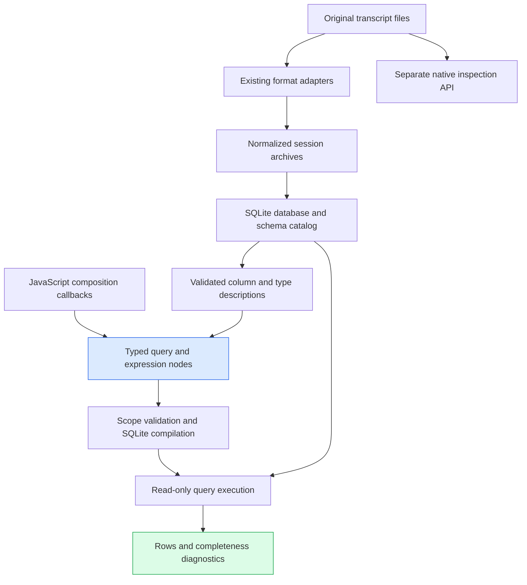

# A composable JavaScript query API and its Go implementation

## 1. Purpose and decisions

This document specifies a clean replacement for go-minitrace's public JavaScript analysis API. It is a design and implementation guide, not a claim that the examples already execute. The baseline is the implementation through commit `5b2c0d9` on `feat/evidence-fidelity`. The user explicitly requested no backward compatibility and authorized reshaping the Go implementation as well as the JavaScript surface.

The central decision is to expose a small grammar of immutable components. A query is composed from a source, predicates, projections, ordering and scalar aggregates. JavaScript functions combine those components. Named analyses are ordinary library functions, not new cases in a Go switch. Build-time callbacks construct expressions; separately declared runtime callbacks transform actual result rows. One typed representation connects this grammar to the SQL compiler and execution layer.

There will be no aliases for old names, compatibility adapters, legacy execution fallback, deprecated-method registry, or period in which documentation teaches both APIs. Implementation may proceed in commits on the feature branch, but the release boundary requires all supported in-repository callers to use the new API. Historical ticket artifacts remain unchanged because they are evidence of earlier experiments, not supported runnable examples.

The design is deliberately smaller than a general data-processing framework. The design supports normalized SQLite data and a narrow relational grammar. It does not add a distributed scheduler, a universal SQL builder, a JavaScript parser, a second JavaScript interpreter, or automatic translation of arbitrary callbacks. Scoped fragments and explicit local runtime callbacks are part of the intended API. The implementation steps below organize the work; they do not define a larger future planning platform.

### Desired properties

- A reader can learn the core grammar once and apply it to different tables.
- A reusable analysis uses the same public operations available to its caller.
- Derived queries never mutate their parents or siblings.
- Query construction performs no data scan; execution is explicit.
- Errors identify the invalid operation, field, scope or parameter.
- Query loss remains visible, and incomplete input cannot become apparently complete output through a transformation.
- The Go model is testable without Goja; the JavaScript binding is a small translation layer.
- A script constructs and executes queries within its own host runtime; callbacks remain ordinary local functions.

## 2. Foundations for a new contributor

A coding agent records user and assistant messages, tool calls, tool results and metadata. Claude Code, Codex and Pi use different native record formats, commonly JSONL: one JSON value per physical line. Go-minitrace adapters interpret those formats and produce normalized session archives. A normalized archive gives subsequent analysis a common vocabulary even when its original records differed.

The normalized database is SQLite, an embedded relational database. Its `sessions`, `turns` and `tool_calls` tables represent conversations, conversational turns and tool records. Session IDs connect related rows. A tool row is not necessarily a distinct successful operating-system process: records can describe orchestration or other activity. Counting rows therefore requires a clear definition of the question being answered.

Native inspection is a separate operation over original files. It preserves physical coordinates, hashes and request-reference diagnostics. A native request may refer to separately stored message blobs and shared configuration records. Missing references cannot be recovered merely by querying normalized tables. The new relational grammar does not pretend native streams and normalized tables are interchangeable.

Goja executes JavaScript inside the Go application. A module loader exposes host functions through `require("minitrace")`. Goja is not Node.js; a script must not assume Node globals exist. The CLI discovers command metadata and invokes JavaScript functions, while SQLite evaluates relational operations. The proposed expression compiler sits between the JavaScript binding and that database execution path.

A **builder** accumulates a description. Its methods return new builders rather than modifying the receiver. An **expression** describes a computation over symbolic columns or bound values. A **plan** is a locally validated query description ready for execution. Its small **intermediate representation** (IR) is the data structure the SQL compiler reads. Immutable descriptions can share child objects without requiring a graph scheduler or shared-execution semantics.

A frontend sandbox and a backend sandbox are alternative hosts for executing a script. They are not the two ends of a plan-transfer protocol. A future browser-local transcript analysis application could load user-selected files, construct queries, execute them and invoke callbacks entirely in the browser. That browser host would need local storage/query capabilities, for example a local SQLite implementation; implementing it is separate work. No transcript or plan upload is implied; a future ZDR web application can implement its analysis locally.



## 3. What exists now and why it should change

`pkg/minitracejs/query_view_session.go` currently defines `QueryRecipeBuilder` with fields such as `kind`, `sessionID`, `includeTools` and `groupBy`. Methods including `ToolRows()` and `SessionToolCounts()` change `kind`. `Build()` selects SQL from a switch and packages it with arguments and descriptive metadata in `QueryRecipe`.

That interface is fluent, but its grammar is a preset selector. Chaining two preset selectors does not compose two analyses: the later selector replaces the earlier kind. Builder wrappers share mutable Go state, so retaining and branching a builder is also different from constructing independent queries. The public methods do not express arbitrary projections, predicates or reusable aggregate expressions.

`SessionToolCounts()` repaired a real analytical hazard. Queries rooted only in `tool_calls` dropped a zero-tool session while retaining the correct total number of tools. The query is useful; requiring a dedicated Go case for every useful query is the architectural issue. The replacement should express this count from reusable primitives and implement the named convenience function in the ordinary library layer.

The current module also exposes overlapping query styles, view/session helpers, convenience aliases and SQL string helpers. The clean cut removes that public duplication. The existing result correctness work remains a requirement, not a compatibility obligation: array-valued results, explicit incompleteness, read-only execution and actionable diagnostics are properties worth implementing cleanly in the replacement.

### Current source reading order

All paths below are relative to `/Users/manuel.odendahl/code/go-go-golems/go-minitrace/.worktrees/feat-evidence-fidelity`.

| Read | What to understand |
| --- | --- |
| `pkg/minitrace/schema.go` | Session, Turn and ToolCall archive entities |
| `pkg/minitracedb/schema.go`, `materialize.go`, `open.go` | SQLite columns, archive loading and materialization |
| `pkg/minitracedb/query.go` | `QueryRunner`, `QueryResult`, normalization, SQLite authorization and read-only checks |
| `pkg/minitracejs/module.go`, `default_module.go` | Goja exports and module registration |
| `pkg/minitracejs/db_builder.go` | Source/configuration accumulation, caching and database ownership |
| `pkg/minitracejs/query_view_session.go` | Current recipe switch and overlapping presentation helpers |
| `pkg/minitracejs/typescript.go` | Current declared public contract |
| `pkg/minitracejs/provider/provider.go` | Integration with host execution |
| `cmd/go-minitrace/cmds/query/command_runtime.go`, `run.go` | CLI execution, result emission and receipts |
| `pkg/nativeevidence/reader.go`, `inspect.go` | Native evidence semantics that must remain separate |

## 4. One public surface, with consistent naming

All new builder methods use lower camel case. Configuration policies are small validated values, not separate families of aliases. Source composition gets its own component because the same source selection is reused across analyses.

```javascript
const mt = require("minitrace");

const inputs = mt.sources()
  .runtimeArchives()
  .build();

const db = mt.db()
  .sources(inputs)
  .import({ autoConvert: false, strict: true })
  .cache({ mode: "memory" })
  .limits({ maxRows: 1000, maxCellBytes: 16000, strict: true })
  .build();

try {
  const sessions = mt.from(db.table("sessions"));
  const plan = sessions
    .select(s => ({ id: s.session_id, title: s.title }))
    .orderBy(s => s.id.asc())
    .build();

  const result = db.execute(plan);
  if (result.error) throw new Error(result.error);
  return result.rows;
} finally {
  db.close();
}
```

`db.build()` opens/materializes the database and may perform I/O. `db.table()` looks up its already available schema catalog; it does not read table rows. Query combinators and query `build()` do not execute SQL. `db.execute()` is the single public query execution method. The distinction between the two kinds of builders is explicit: a database builder creates a resource; a query builder creates a description.

The source builder accepts `files(paths)`, `glob(pattern)`, `content(text, { name })` and `runtimeArchives()`. In-memory content retains synthetic-fixture and raw-import use cases; the name is a diagnostic label, not a filesystem write. It rejects an empty resolved selection rather than silently inventing an input. Its built value is immutable. Source identity, duplicate/conflict inspection and import policy remain separate concerns: combining selectors does not silently choose between conflicting archives. Cache mode and query strictness are independent policies.

### Public component inventory

| Component | Methods or exports | Responsibility |
| --- | --- | --- |
| Sources | `mt.sources`, `files`, `glob`, `content`, `runtimeArchives`, `build` | Describe input selection |
| Database | `mt.db`, `sources`, `import`, `cache`, `limits`, `cacheKey`, `build` | Construct owned database resource |
| DB handle | `table`, `tables`, `schema`, `stats`, `sources`, `diagnostics`, `cacheInfo`, `execute`, `close` | Catalog discovery and execution |
| Query | `mt.from`, `where`, `select`, `orderBy`, `count`, `use`, `build` | Relational grammar |
| Expressions | `eq`, `ne`, `gt`, `gte`, `lt`, `lte`, `and`, `or`, `not`, `isNull`, `isNotNull`, `contains`, `asc`, `desc` | Explicit typed operations |
| Parameters | `mt.param`, `default`, `range`, `ui` | Named bindings and optional UI descriptions |
| SQL escape hatch | tagged `mt.sql`, `columns` | Bound SQL as an opaque relational source |
| Plans | `explain`, `parameters` | Local inspection and execution description; no import/export protocol |
| Host/import capabilities | `mt.runtime`, `mt.importer`, `mt.native`, `mt.corpusManifest`, `mt.utf8ByteLength` | Host metadata, conversion and evidence operations outside query grammar |
| Customization | `extend`, `mt.fragment`, `mapRows` | Scoped domain methods and ordinary local runtime callbacks |

There is no new `queryOne`, rows-only `query`, `queryResult`, `Run`, or `Plan` alias. To select a small result, express the selection in the query or SQL escape hatch and inspect the returned envelope. General row limiting can be added as a distinct relational operation after its interaction with safety limits is tested; it is not needed to make the initial grammar useful.

`mt.native()` remains a separate component, but its exported method names are also migrated to lower camel case in this clean cut. `mt.corpusManifest()` and `mt.utf8ByteLength()` retain their existing lower-camel names and semantics. Reusing a correctly named operation is not maintaining a parallel legacy interface. Native inspection does not become `mt.from(nativeFile)` implicitly.

## 5. Expressions and callback timing

A query callback receives a symbolic row. Reading `s.session_id` yields a column expression with a type and an owner scope. Calling `.eq("abc")` creates a comparison node; the string becomes a bound value. The callback runs when the combinator is called. `build()` validates the accumulated graph and does not rerun callbacks.

```javascript
const selected = sessions.where(s =>
  s.agent_framework.eq("codex").and(s.title.contains("context"))
);
```

This uses ordinary JavaScript function invocation. We neither inspect function source nor infer SQL from its AST. JavaScript remains free to compute constants or choose which components to add outside symbolic expressions:

```javascript
const forFramework = (query, framework) =>
  framework == null
    ? query
    : query.where(s => s.agent_framework.eq(framework));

const selected = forFramework(sessions, userChoice);
```

The following is invalid because JavaScript evaluates `===` before the builder sees its result:

```javascript
sessions.where(s => s.agent_framework === "codex");
// E_EXPECTED_PREDICATE at where[0]: received boolean.
// Use s.agent_framework.eq("codex").
```

Proxy objects can improve unknown-field diagnostics, but cannot redefine JavaScript operators or object truthiness. In particular, `if (s.title.eq("x"))` treats the expression object as truthy and cannot be reliably detected after the callback chooses a branch. Documentation and examples must prohibit symbolic expressions in JavaScript conditionals. Do not promise a proxy can catch every misuse.

Callbacks must return the expected shape synchronously. Promise results are rejected, not awaited. `where` requires a boolean expression, `select` requires an object mapping output names to expressions or supported literals, and `orderBy` accepts an order expression or an array of them. Getter/then/prototype behavior must be tested at the Goja boundary so inspection or Promise detection does not fabricate columns named `then` or other introspection properties.

### Types, nulls and field names

The first scalar types are string, boolean, integer and number, each with explicit nullability. Parameter integers must be finite safe JavaScript integers. Unsupported values such as arbitrary objects, functions or symbols are rejected as SQL values. Native raw JSON remains available for exact source evidence; the query grammar is not an implicit arbitrary-precision conversion policy.

`eq(null)` is rejected with a hint to use `isNull()`. Logical operators follow SQL's three-valued logic; a null predicate does not select a row. `contains(text)` means a literal, case-sensitive substring and can compile through SQLite `instr`, avoiding accidental LIKE wildcard semantics. More text matching modes should be named separately when needed.

Column access validates against the current input schema. Database identifiers are resolved from the catalog and quoted by the compiler; user values are bound. A projected output name changes the next callback's schema:

```javascript
const names = sessions.select(s => ({ id: s.session_id }));
names.where(s => s.id.eq("abc"));       // Valid.
names.where(s => s.session_id.eq("abc")); // Unknown field; available: id.
```

## 6. Scope and immutable branching

Each relational node defines the row scope visible to its callbacks. Column expressions carry a scope identifier and column identifier, not merely a string. That prevents a retained symbolic row from accidentally becoming a reference to an unrelated query.

```javascript
const base = sessions.where(s => s.agent_framework.eq("codex"));
const names = base.select(s => ({ id: s.session_id, title: s.title }));
const identifiers = base.select(s => ({ id: s.session_id }));
// Neither derived query changes base or its sibling.
```

Immutability includes argument slices, maps, projection definitions and parameter descriptors, not just the top-level builder. Copy those structures at API boundaries. Goja row objects should expose validated accessors rather than writable fields that mutate the IR. Repeated `build()` calls must return equivalent plans without callback side effects.

Each `orderBy` replaces the previous explicit order specification; use one array to express multiple keys. Sorting does not make ties deterministic: callers must add a unique tie-breaker, such as session_id, when reproducibility requires it. A pure count ignores input ordering because the initial grammar has no cardinality-changing limit operator. Raw SQL source ordering is not inherited as a guaranteed outer order; apply orderBy explicitly.

A projection followed by a filter over its aliases must compile using a derived table or equivalent correct nesting. Do not substitute aliases into a same-level WHERE clause by accident. The initial compiler should favor straightforward nested SELECTs and deterministic generated aliases over a rewrite optimizer. It must preserve explicit sort semantics across projections and filters, lifting or reapplying order keys when necessary; SQL does not guarantee that a sort inside an arbitrary derived table determines final output order. For the initial compiler, a projection must expose the current ordering expressions under output names so they can be rebound; otherwise reject the composition with an actionable error. Do not add hidden projection columns in this first version. Do not silently drop ordering.

## 7. Aggregates and recipes through composition

`count()` is a scalar aggregate expression over a query. It counts rows in that query, including the well-defined zero result. It is not an eager count and does not load rows into JavaScript.

```javascript
const tools = mt.from(db.table("tool_calls"));

const inventory = sessions.select(s => ({
  session_id: s.session_id,
  tool_count: tools
    .where(t => t.session_id.eq(s.session_id))
    .count(),
}));
```

Here the inner predicate references the enclosing session scope. The resulting SQL is equivalent to:

```sql
SELECT s.session_id,
       (SELECT COUNT(*)
        FROM tool_calls t
        WHERE t.session_id = s.session_id) AS tool_count
FROM sessions s;
```

A session with no tools remains an outer row and receives zero. There is no outer join placeholder to count accidentally. The compiler validates that the outer scope is an ancestor of the aggregate's use site and that both sources belong to the same database binding. References to unrelated branches or a different database handle are errors. Correlation is lexical, not inferred from relational graph ancestry: each callback receives a newly allocated scope owned by its enclosing operation, and nested callbacks may capture only scopes active in that enclosing construction. An aggregate records its free scope IDs. Validation binds them at the aggregate use site; saving a correlated aggregate and inserting it into an unrelated later projection is rejected even if the two queries share an input node. Ordinary uncorrelated query nodes remain reusable.

A named recipe becomes an ordinary function:

```javascript
function withToolCounts(query, tools) {
  return query.select(s => ({
    session_id: s.session_id,
    framework: s.agent_framework,
    tool_count: tools.where(t => t.session_id.eq(s.session_id)).count(),
  }));
}

const counts = sessions
  .use(q => withToolCounts(q, tools))
  .where(s => s.tool_count.gte(10))
  .orderBy(s => [s.tool_count.desc(), s.session_id.asc()]);
```

`use(fn)` calls `fn(query)` and validates that the result is a query in the same construction context. It does not create a special IR node. This function intentionally produces a documented projection; it does not promise to preserve every incoming column. A future projection-extension operation should be justified by repeated usage rather than introduced through implicit object spread over symbolic rows.

Correlated COUNT is the first aggregate because it solves a demonstrated problem with a small implementation. General joins, grouping, windows, unions, recursive queries and distinct counting are outside this grammar. The SQL escape hatch covers analyses outside this grammar. Test representative real-corpus timings and inspect SQLite query plans before replacing correct correlated subqueries with a more elaborate aggregate-join rewrite. Repeated row scanning is a possible performance cost, not a reason to add an untested optimizer upfront.

## 8. Parameters and UI descriptions

Parameters are named typed expressions whose values are supplied at execution. Their descriptors are immutable plan data. UI attributes describe possible controls but never substitute for execution-side validation.

```javascript
const minimumTools = mt.param.integer("minimumTools")
  .default(0)
  .range(0, 200)
  .ui({ widget: "slider", label: "Minimum tool calls" });

const plan = sessions
  .use(q => withToolCounts(q, tools))
  .where(s => s.tool_count.gte(minimumTools))
  .build();

plan.parameters();
const result = db.execute(plan, { params: { minimumTools: 5 } });
```

At build time, repeated uses of a name must have identical type, constraints and default; conflicting declarations are errors. At execution, resolve defaults, reject missing required values and unknown parameter names, validate types/ranges, and create the positional SQL argument list in deterministic compiler traversal order. Multiple SQL placeholders can reference the same named binding.

Changing a slider supplies a different parameter value to the same plan. It does not rerun build-time lambdas. Structural choices, such as selecting a different table, require constructing another query. Identifiers cannot be bound through value parameters.

The initial UI vocabulary is descriptive metadata only: `widget`, `label`, and optional help text. Integer ranges support sliders; strings and booleans can support text and checkbox controls. No frontend widget library is part of this change. A future browser-hosted implementation validates parameters against its local schema and executes the same script locally. It does not need to send a query description to a backend.

## 9. SQL escape hatch without a second execution API

A tagged template creates an opaque SQL source. For direct execution, a SQL source needs no declared columns: the prepared statement and result supply its schema. Add `.columns(...)` before symbolic composition so field/type validation remains deterministic. This avoids forcing every existing SQL-only script to duplicate its result schema. Interpolations are bound values or named parameter expressions, never identifiers or SQL fragments.

```javascript
const query = mt.sql`
  SELECT session_id, title
  FROM sessions
  WHERE agent_framework = ${"codex"}
`.columns({
  session_id: mt.type.string(),
  title: mt.type.string().nullable(),
});

const plan = query.orderBy(s => s.session_id.asc()).build();
const result = db.execute(plan);
```

A raw SQL source starts unbound. Composing it with a locally bound query adopts that one database identity for the resulting plan; composing two different bound identities fails. An entirely unbound plan binds to the receiver of db.execute(). This does not grant its SQL access to any additional tables. For example, a declared SQL source selecting session_id from tool_calls can be filtered inside sessions.select(s => ...) using t.session_id.eq(s.session_id), then counted; it adopts the sessions database and follows the same lexical correlation validation as a table source.

This replaces the current `mt.sql` object of string-formatting helpers. There is no compatibility object attached to the new tag. SQL remains subject to read-only preparation, authorization, timeout and result limits. Declared columns enable composition; they are checked against actual prepared/result metadata and values where SQLite cannot provide precise static types. A declaration is not permission to fabricate missing columns.

Direct execution preserves the SQL statement and its final ordering; the compiler wraps this source as a derived table only when composing outer operations. Such composition requires declared columns and explicit outer ordering where order matters. It must support exactly one embeddable SELECT/WITH query. It must not remove trailing semicolons or comments using ad hoc concatenation rules that can change meaning. Establish a tested normalization/validation helper, reusing the current read-only query machinery where appropriate, and reject unsupported statement forms. Do not build a JavaScript parser to support this feature.

## 10. IR, SQL compiler and Go package boundaries

The present Go architecture should be reshaped around these concepts rather than accumulating more methods on `QueryRecipeBuilder`. The following files/packages are proposed, not current files.

| Location | Responsibility |
| --- | --- |
| A small pure-Go query model/compiler, provisionally `pkg/queryplan/` | Expression structs, schema/scope checks and SQL compilation; no Goja or connection ownership |
| `pkg/minitracejs/` | Builders, symbolic rows, fragments and local callbacks; thin bindings over the query model |
| `pkg/minitracedb/` | Database ownership, read-only execution, cancellation and shared result-limit handling |
| Ordinary JS analysis library | Reusable recipes and domain fragments composed through public operations |

These are responsibilities, not a requirement for a package, interface or pipeline stage for every operation. Start with model and compiler files plus the existing binding and database packages. Keep validation near constructors and compilation until its size warrants another file. No standalone planner, optimizer, scheduler, function registry, or plan-binding subsystem is required. Go internals may be renamed or extracted as needed; there is no requirement to preserve old public Go constructors.

A conceptual Go model follows. This is pseudocode, not a requirement to expose these fields directly:

```go
type QueryNode struct {
    Op       QueryOp // Table, Filter, Project, Order, RawSQL
    Input    *QueryNode
    Schema   Schema
    // Typed per-operation payload, not an unrestricted map[string]any.
}

type Expression struct {
    Op       ExprOp // Column, Literal, Param, Compare, Logic, Count, OrderKey
    Type     ScalarType
    Scope    ScopeID // For column references.
    Children []*Expression
    Query    *QueryNode // For scalar Count.
}

type CompiledQuery struct {
    SQL      string
    Bindings []BindingSlot // Constant or named parameter.
    Columns  Schema
}
```

Use tagged typed payloads or small concrete node types with exhaustive switches. Prevent invalid combinations such as a Table node carrying both a predicate and projection. Representation simplicity matters more than eliminating every switch: a switch over a small fixed grammar is appropriate; a switch over every domain analysis is not.

Builders create immutable child references; the compiler walks those descriptions. Shared query inputs may be compiled more than once. There is no node registry, graph interchange schema, materialization scheduler or promise that shared work runs once. Keep scope identifiers for correct correlated column resolution, not as distributed graph identities.

### Compilation algorithm

```text
build(query):
    freeze owned maps/slices and parameter descriptors
    validate node references, types and lexical scopes
    reject unsupported stage order and invalid output names
    return immutable local plan with query and output schema

compile(plan):
    assign deterministic SQL aliases to scopes
    lower each relational operation with correct nesting
    resolve column references against the active scope chain
    append placeholders and corresponding binding slots
    emit correlated COUNT subqueries in their legal enclosing scope
    return SQL, binding slots and expected output schema

execute(context, db, plan, suppliedParameters):
    verify local database ownership and referenced columns
    validate/default parameters and resolve binding slots
    run compiled SQL through existing read-only authorization
    enforce timeout, row/cell limits and result normalization
    return result envelope; never bypass diagnostics for generated SQL
```

Identifier quoting and value binding are mandatory even for compiler-generated queries. Keep practical bounds on expression depth, projection width, literal sizes and generated SQL length so accidental pathological scripts fail clearly. Preserve SQLite's authorizer as a separate enforcement boundary; a correctly typed IR is not an authorization mechanism.

## 11. Ownership, errors and evidence results

A DB handle owns its database resources. `close()` is idempotent. Executing after close returns a clear execution error. Queries constructed from two live DB handles cannot be merged in the initial grammar, even if their table names happen to match. A table-bound query belongs to the database that supplied its tables; it cannot execute after that handle closes or against another handle.

Keep a local owner reference on table-backed queries and reject a conflicting execution receiver. A SQL-only query without table handles uses the database passed to execute. This is ordinary local resource ownership, not a rebinding protocol. Nothing crosses a host boundary, and no serialized source identities or schema negotiation are needed.

Build errors throw a structured JavaScript Error with `code`, `path` and a human-readable message. Query/runtime execution errors use the result envelope with array-valued `rows` and `columns`, `complete: false`, zero exposed partial rows, and an error message. Add structured execution diagnostic fields only with a single documented schema shared by Go and TypeScript; do not create a different error format per stage.

`complete` means no result loss under the configured query execution rules. It does not certify that the captured transcript contains every historical event, nor that a SQL query selected all logically relevant rows. Strict mode rejects incomplete rows before emission. Permissive relational execution returns its diagnostics. Safety row limits and SQL-level selection are distinct concepts and must remain distinguishable in receipts.

Useful diagnostic examples:

```text
E_UNKNOWN_COLUMN select[0].id: sessions has no column "id".
Available: session_id, title, agent_framework, ...

E_SCOPE where[1]: column belongs to a sibling query scope.
Build the predicate using the row passed to this callback.

E_PARAMETER minimumTools: expected integer in [0, 200], received 201.

E_STAGE_ORDER where[2]: SQL filtering cannot follow mapRows().
Move the filter before mapRows or perform explicit ordinary JS processing.
```

Do not dump full transcript content or bound secrets into diagnostics. Include operation location and safe type/field information; richer debug receipts require deliberate caller choice.

## 12. Local runtime callbacks

Runtime processing is useful for formatting or domain calculations that should remain ordinary JavaScript. Implement it after the relational operations so the input/output boundary has clear semantics. `mapRows()` is initially a terminal, one-input-row/one-output-row operation; it neither filters nor aggregates.

```javascript
const plan = sessions
  .use(q => withToolCounts(q, tools))
  .mapRows(row => ({
    session_id: row.session_id,
    label: `${row.tool_count} calls`,
  }), {
    columns: {
      session_id: mt.type.string(),
      label: mt.type.string(),
    },
  })
  .build();
```

Unlike `select`, this callback receives actual records and runs during execution. Explicit output columns let the runtime validate returned objects without guessing the schema from the first row, which would fail for empty input. SQL combinators are unavailable after this stage. A later separate JS filter operation would need its own output-count and coverage contract; do not smuggle filtering into `mapRows` through null returns.

For runtime mapping, require complete SQL input even if the underlying database permits incomplete relational results. This avoids applying arbitrary callbacks to clipped values and then losing the relationship between input diagnostics and transformed columns. If SQL input is incomplete, return an error before invoking callbacks. Do not silently mark transformed output complete.

Apply the same configured limits to the mapped output. Refactor `normalizeCellWithDiagnostic` and related result-policy handling into a reusable Go helper rather than duplicating truncation behavior. Output diagnostics refer to the final mapped schema. Validate each returned row and stop on errors; no partial mapped rows are exposed on failure. A callback error identifies its stage and row index without printing the source row.

Run Goja callbacks serially on the owning runtime. Do not call a VM from worker goroutines. Pass cancellation through database work and use the runtime's interruption mechanism for long-running callbacks; reset interruption state carefully before any runtime reuse. This is not a hard memory sandbox. Where untrusted callback execution needs hard memory isolation, use a process boundary rather than pretending query limits constrain arbitrary JavaScript allocation.

## 13. Scoped fragments and local execution hosts

Ordinary functions are the default reuse mechanism. Fragments provide scoped vocabulary when a group of operations deserves discoverable domain names. They extend one query value, not a global prototype.

```javascript
const sessionAnalysis = mt.fragment({
  name: "session-analysis",
  target: "query",
  requires: ["session_id", "agent_framework"],
  methods: {
    forFramework(query, framework) {
      return query.where(s => s.agent_framework.eq(framework));
    },
    withToolCounts(query) {
      return withToolCounts(query, tools);
    },
  },
});

const analysis = sessions.extend(sessionAnalysis);
const plan = analysis.forFramework("pi").withToolCounts().build();
```

Reject collisions with core methods and other installed fragments. Check required columns on each method invocation, not only at extension time: a projection can remove them. Fragment methods return a query from the same construction context. Each derived builder retains its fragment methods; invocation rechecks the current schema. No global registration, installation hook, unloading or serialized fragment identity exists. Fragment expansion produces ordinary nodes; the query representation contains no special `session-analysis` operation. The fragment functions run locally while constructing the query.

Runtime callbacks remain ordinary JavaScript functions, including closures:

```javascript
const suffix = preferences.countLabel;
const plan = sessions
  .use(q => withToolCounts(q, tools))
  .mapRows(row => ({ label: `${row.tool_count} ${suffix}` }), {
    columns: { label: mt.type.string() },
  })
  .build();
const result = db.execute(plan);
```

The function stays in its owning runtime and reads captured variables according to normal JavaScript semantics when invoked. It is not automatically frozen with the query description; avoid mutating captured state if repeatable results matter. No name, version registration, function serialization or remote resolver is involved. Fragments likewise close over local helpers and query sources normally.

A backend host can implement these operations with Goja and SQLite. A future browser host can implement the same public behavior with browser-local facilities and execute the entire script there, including its callbacks. These implementations should share behavioral fixtures and contract tests; they need not exchange IR or share identical internal representations. Avoid Node-only assumptions in the domain library. Implement the browser backend when browser-local analysis is actually being built, rather than adding a speculative execution transport now.

## 14. Clean-cut migration and deletion plan

This is a replacement, not a compatibility project. Search for callers and assign each to supported product code, maintained examples/tests, or historical evidence. Migration must cover CLI built-ins, provider integrations, maintained documentation and any web-facing scripts that invoke the module. Do not edit old experiment outputs to make them resemble the new API.

| Existing public area | Replacement action |
| --- | --- |
| `mt.query().ToolRows()/SessionToolCounts()/...` | Remove preset selector; implement maintained analyses as composition functions or explicit SQL sources |
| Uppercase DB/source/policy methods and aliases | Remove exports; expose only the new lower-camel builders |
| `query`, `queryOne`, `queryResult`, `execute(recipe)` variants | Replace with one `execute(plan, options)` contract |
| `QueryRecipe` SQL/args wrapper | Replace with typed plan plus compiler output |
| `mt.view()` / `mt.session()` overlapping analysis helpers | Inventory actual behavior; move needed presentations to ordinary library functions or explicit runtime stages, then remove old exports |
| SQL quoting helper object | Remove; use tagged bound SQL |
| Manual declaration lists | Replace/update declarations from the new API contract and test against runtime exports |
| Historical ticket JS/SQL and frozen transcripts | Preserve as versioned evidence; explicitly label non-current |

The CLI's command-discovery mechanism, including external `__verb__` metadata, is a separate host integration. It need not be replaced to change the minitrace module. However, scripts invoked by that host must be migrated, and capability inference must recognize the new source builder rather than relying on obsolete method spellings. SQLite archive schemas, native file formats and adapter semantics are not automatically redesigned merely because JavaScript APIs are removed.

Acceptance includes tests that old exports are absent. Documentation must contain one current vocabulary. A migration table can explain changes for developers, but it is not a runtime adapter or a commitment to keep old scripts working.

## 15. Implementation sequence for an intern

### Milestone 1: Inventory and semantic fixtures

Read the current source paths listed earlier, trace one CLI command through Goja to QueryRunner, and write a compact call-site inventory. Locate current archive types with `rg` and verify actual SQL columns from `schema.go`. Identify code relying on mutable builder branching, preset output names, implicit runtime flags and rows-only query methods. Do not begin by mechanically renaming uppercase methods.

Create fixtures with three sessions, one with zero tool rows, misleading stored metrics, nullable titles and distinct framework values. Reuse the existing native and fidelity fixtures for unrelated semantics. Record expected per-session identities and counts, not just totals. Define the small new TypeScript contract before implementing dozens of convenience methods.

### Milestone 2: Pure-Go relational core

Implement typed nodes, schemas, scopes and parameter descriptors. Add immutable constructors and query validation. Implement Table, Filter, Project, Order and scalar Count lowering with deterministic aliases and binding order. Execute compiled queries through the existing database runner, preserving authorization and evidence semantics. This milestone should be testable without loading Goja. Track lexical free-scope sets independently of relational input edges and test escaped correlated-expression reuse.

Use semantic result comparisons, not only golden SQL strings: different SQL strings can be equivalent, and visually plausible SQL can have wrong scope or ordering. Include a projected-alias filter, correlated zero count, duplicate parameter references and sibling-scope rejection.

### Milestone 3: New JS binding and one end-to-end command

Implement lower-camel source/DB builders, catalog-backed symbolic rows, expression constructors and query combinators. Run callbacks at combinator invocation, validate return values immediately, and produce plans at build. Add `db.execute(plan)` and remove alternative public execution forms during the coordinated cutover.

Rewrite one maintained command to use `withToolCounts`. Test the real CLI path, not only direct Goja evaluation. Verify runtime archive flags are still offered by the command host. This proves the binding, compiler, runner and output path work together before domain-library expansion. Implement the tagged SQL source and its declared-column validation at this milestone too, before migration: existing grouping, union and window analyses need an escape hatch that is not covered by the intentionally small grammar.

### Milestone 4: Finish supported-call-site migration

Migrate the remaining built-in analyses to functions or tagged SQL. Remove the recipe switch, old view/session exports, aliases, old declarations and obsolete tests. Preserve actual behavior intentionally where it remains desired, but do not retain public surface merely because it existed. Keep tests for correctness properties even when their invocation syntax changes.

Publish the new API reference and executable getting-started examples in `pkg/doc`. Run embedded help loading. Search again for old exported spellings in supported paths and distinguish intentional historical matches under `ttmp` from missed migration work.

### Milestone 5: Parameters and scoped fragments

Add typed parameter descriptors, execution-time validation/defaults and UI metadata. Extend the SQL source to accept named parameter expressions as well as literals. Implement scoped fragments as local method expansion: reject collisions, validate required fields at invocation, and keep extensions off global prototypes. Test fragment reuse across immutable branches and informative failures after projections remove required fields.

### Milestone 6: Local runtime callbacks

Implement terminal `mapRows` with explicit output schema, complete-input requirement, cancellation and final output limits. Invoke ordinary callbacks on the owning Goja runtime and preserve closure semantics. No registry or transport work is part of this milestone. Keep the fragment implementation limited to public composition operations rather than introducing privileged SQL shortcuts.

### Milestone 7: Persona validation against the new contract

Run a small pilot before a fixed matrix. Every generated command task must include a valid zero-tool session. Require a final machine-valid mandatory answer before starting optional exploration as a separate task. Pin the executable and corpus, enforce the current protected-path/read policies, preserve receipts and replay generated commands with host-controlled argv.

Distinguish build-time callback misuse, SQL compiler bugs, execution-limit failures, task ambiguity and generated-code defects. A successful output does not validate every saved script or explanatory claim. Do not compare token counts or elapsed time causally against the old cohort after changing tasks and APIs.

## 16. Acceptance matrix and validation commands

The following checks describe the complete intended local API: composition, parameters, scoped fragments, local runtime mapping and migrated callers. Milestones are an implementation order, not separate product tiers. A future browser host gets parity tests when it is built; it is not a prerequisite for this Goja implementation.

| Boundary | Required evidence |
| --- | --- |
| Immutability | Deriving and modifying two branches leaves parent and sibling plans unchanged |
| Callback timing | Each build-time callback runs once at combinator call; repeated build never reexecutes it |
| Scope | Legal correlated count succeeds; escaped/sibling/cross-DB references fail |
| Query meaning | Zero-tool identities survive; stored metrics do not replace actual counts |
| Projection/order | Alias filters compile correctly; explicit ordering is preserved, repeated orderBy replaces rather than appends, ties require caller-provided keys |
| Binding | Quotes and SQL punctuation remain values; defaults/ranges/unknown params are checked |
| Proxy behavior | Misspelled fields give catalog hints; JS operators and Promise returns produce useful errors where detectable |
| Read-only safety | Compiled and raw SQL both pass through SQLite authorization and read-only checks |
| Evidence | Empty arrays on errors, UTF-8 clipping, row overflow and strict no-emission remain correct |
| Runtime callbacks | No callback on incomplete input; empty input has known schema; mapped output limits/cancellation work |
| Scoped fragments | Methods stay local, collisions fail, current-schema requirements are checked and branches remain independent |
| Local inspection | explain reports query structure and parameter descriptors without promising a stable interchange format |
| Clean cut | Removed exports truly absent; every supported script and reference uses the new API |

Run focused new package tests first, then `go test ./pkg/minitracedb ./pkg/minitracejs ./pkg/minitracecmd ./cmd/go-minitrace/cmds/query`, followed by `go test ./...`, `go build ./...`, `go vet ./...`, repository lint and `go run ./cmd/go-minitrace help --all`. Use the canonical macOS temporary path when comparing to prior validation. The preceding work recorded two baseline configuration-precedence test failures and an unavailable golangci-lint executable; re-evaluate and report their actual state instead of silently carrying forward a green or red conclusion.

No frontend rebuild is required for pure-Go/module work. If implementation changes the embedded web application, follow the repository's Dagger/pnpm build instructions. Do not regenerate unrelated frontend assets merely to finish the API cutover.

## 17. Tradeoffs and scope boundaries

Correlated aggregates are simple and preserve empty parent rows, but may execute repeated scans. Start with correctness and profile representative corpora; add indexes or a proven rewrite only where evidence warrants it. Immutable query descriptions allocate more small descriptions than a mutable selector, but simplify reuse, diagnostics and testing. Avoid interning or hash-consing until measured allocation pressure warrants it.

Symbolic callbacks require explicit `.eq()` and related methods. This is less syntactically transparent than JavaScript operators, but makes the no-parser design honest and predictable. Runtime callbacks retain normal JavaScript semantics at a clearly different stage. TypeScript assists authoring but cannot validate a column schema supplied by a different runtime database; runtime checks remain mandatory.

General joins/grouping/windows, arbitrary runtime filtering and multi-database federation are outside the small initial grammar; raw SQL covers more advanced relational analyses. Plan transport, import/export, cross-host rebinding, runtime-function registries and distributed scheduling are not part of this design. If a future agent API needs filesystem or administrative mutations, give it explicit capability-scoped action methods with separate execution receipts. Do not disguise side effects as relational query nodes.

The replacement is successful when an intern can express a session inventory, a reusable count analysis and a parameterized filter with a handful of operations, inspect their plans, and predict when callbacks and I/O occur. It is not successful merely because the new method chains look shorter.

## 18. References and handoff

The immediate design background is this ticket's `design-doc/03-persona-review-followups-result-contracts-discoverability-and-enforced-test-isolation.md`. The measured findings are in `reference/13-review-followup-implementation-and-v2-validation-results.md` and `reference/14-v2-persona-transcript-review.md`. The previous recipe and native projection regressions are in `pkg/minitracejs/session_tool_counts_test.go` and `native_evidence_test.go`; preserve their semantic intent through the clean cut.

Implementation should begin with a new scoped source branch or the explicitly chosen continuation of this worktree, a call-site inventory, and tests for the pure-Go grammar. This document does not itself authorize a hidden compatibility bridge or claim the new runtime is implemented. The requested deliverable for this step is the complete design and its reMarkable edition.

## 19. Existing scripts: before and after

This section reviews the repository-visible `.js`, `.mjs` and `.cjs` files at the design checkpoint. The reproducible inventory is `scripts/04-inventory-js-api-migration.py`; its output is `sources/js-api-migration-inventory.json`. It records 267 files, 530,212 bytes and 240 distinct content hashes: 28 maintained module/example scripts, 232 historical ticket scripts and seven web/generated files. Dependencies, ignored build output and JavaScript strings embedded inside Go or Markdown are outside this file count. Those embedded examples still belong to the implementation call-site search in milestone 1. This is a design review, not a claim that the proposed API has been implemented or the rewritten snippets executed.

Before examples below are excerpts or abbreviated forms of the named scripts. After examples specify the replacement contract. Unchanged SQL bodies and unchanged pure-JS functions are identified explicitly; the inventory in section 20 maps every discovered file to these migration families. Historical originals stay intact. Comparing an original with this guide is useful; rewriting the recorded experiments would destroy that comparison.

### M1. Resource construction and in-memory inputs

Most maintained commands currently open a database this way:

```javascript
// Before: core/history/context-window.js and the showcase commands.
const db = mt.db().RuntimeArchives().QueryCommandDefaults().Build();

// After: QueryCommandDefaults currently means these two import settings.
const db = mt.db()
  .sources(mt.sources().runtimeArchives().build())
  .import({ autoConvert: true, strict: true })
  .build();
```

Do not copy the earlier `autoConvert: false` example into these commands: that would drop raw transcript conversion. Cache selection remains independent; changing an uncached command to a memory cache is an intentional policy choice, not part of renaming its methods. Existing numeric limits, timeouts and strictness must be carried across explicitly. The proposed `limits` object includes `maxRows`, `maxColumns`, `maxCellBytes`, `timeoutMs`, `requireOrderBy` and `strict`. The current `CellChars`/`MaxCellChars` names are deprecated byte-limit aliases, so migrate them to `maxCellBytes` with the same numeric value; do not invent a character-count behavior. The `cache` object retains `mode`, `dir`, `maxBytes` and `forceRebuild`, using the existing cache policy semantics rather than a new cache subsystem.

```javascript
// Before: query-fidelity/fidelity-probe.js.
const db = mt.db().Content(source).SQLiteMemory()
  .MaxCellBytes(3).MaxRows(1).StrictEvidence(strict).Build();

// After: the same synthetic source and deliberate output constraints.
const db = mt.db()
  .sources(mt.sources().content(source, { name: "fidelity-probe" }).build())
  .cache({ mode: "none" })
  .limits({ maxCellBytes: 3, maxRows: 1, strict })
  .build();
```

`SQLiteMemory` selects an in-memory backing store; it does not mean a reusable memory cache. The default uncached database remains in memory. `content` accepts the same normalized/raw text supported by current content loading, with raw conversion controlled by import policy.

An immutable source builder also changes a loop found in the historical GLM token-provenance commands:

```javascript
// Before: calls mutate s.
const s = mt.sources();
for (const p of paths) s.File(p);
const inputs = s.Build();

// After: one explicit collection; no ignored builder results.
const inputs = mt.sources().files(paths).build();
```

### M2. One execution envelope, with SQL retained where appropriate

The five core commands, five docmetrics scripts and most showcase queries contain joins, aggregates, windows or SQL LIMIT. Keep their SQL semantics. Direct tagged SQL execution does not require `.columns`; declarations become necessary when composing symbolic operations on its output.

```javascript
// Before: examples/xgoja/minitrace-jsverbs/verbs/inspect.js, tools().
return db.query(`
  SELECT tool_name, COALESCE(operation_type, '') AS operation_type,
    COUNT(*) AS calls,
    SUM(CASE WHEN success = 0 THEN 1 ELSE 0 END) AS failures
  FROM tool_calls GROUP BY tool_name, operation_type
  ORDER BY calls DESC, tool_name ASC, operation_type ASC LIMIT ?
`, limit || 10);

// After: retain aggregation, ordering, selection and output columns.
const result = db.execute(mt.sql`
  SELECT tool_name, COALESCE(operation_type, '') AS operation_type,
    COUNT(*) AS calls,
    SUM(CASE WHEN success = 0 THEN 1 ELSE 0 END) AS failures
  FROM tool_calls GROUP BY tool_name, operation_type
  ORDER BY calls DESC, tool_name ASC, operation_type ASC LIMIT ${limit || 10}
`.build());
if (result.error || !result.complete) {
  throw new Error(result.error || "Incomplete tool summary");
}
return result.rows;
```

A directly executed opaque SQL source runs its statement without an unnecessary outer wrapper, preserving its final ORDER BY. Once composed as a relational source, its inner ordering is not a promise of outer ordering: specify `orderBy` on the composed query. SQL LIMIT chooses the intended population; an execution safety cap reports incomplete output if it clips that population. They are different operations.

A command can define an ordinary helper to check a result envelope. That is application code, not another exported execution API:

```javascript
function completeRows(result) {
  if (result.error || !result.complete) {
    throw new Error(result.error || "Incomplete query input");
  }
  return result.rows;
}
```

For intentional fidelity probes, inspect the incomplete envelope rather than passing it through this helper. For a former `queryOne` caller, extract `rows[0] ?? null` only after checking the envelope, and choose whether empty input is valid. Retain an explicit SQL LIMIT 1 when the original query selects one row; fetching the whole corpus then discarding it could hit safety caps and change behavior.

### M3. Binding filters without changing their meaning

Core history commands use `mt.sql.like`, while scoreboards also use `mt.sql.stringIn`. Neither is replaced by inserting SQL strings into the new tag.

```javascript
// Before: core/history/ticket-timeline.js, abbreviated.
const like = mt.sql.like(fragment);
const rows = db.query(`SELECT * FROM turns WHERE content LIKE ${like}`);

// After: wildcard pattern is a bound value.
const result = db.execute(mt.sql`
  SELECT * FROM turns WHERE content LIKE ${"%" + fragment + "%"}
`.build());
```

The existing helper adds surrounding `%` and leaves SQL wildcard behavior inside the input intact. `.contains()` is a literal case-sensitive operation in this design, so substituting it changes semantics. Keep LIKE where LIKE was intended.

For dynamic framework lists in advanced SQL, bind framed hexadecimal UTF-8 keys and compare them with SQLite scalar functions. An empty list uses null. The encoding preserves exact membership, including empty strings and names that contain a separator.

```javascript
const frameworks = filters.framework || [];
const keys = frameworks.map(value => encodeURIComponent(value)
  .replace(/%[0-9A-F]{2}|./g, token => token[0] === "%"
    ? token.slice(1)
    : token.charCodeAt(0).toString(16).padStart(2, "0").toUpperCase()));
const frameworkKeys = frameworks.length ? "|" + keys.join("|") + "|" : null;
const result = db.execute(mt.sql`
  SELECT s.agent_framework, COUNT(*) AS sessions
  FROM sessions s
  WHERE (${frameworkKeys} IS NULL OR (
    s.agent_framework IS NOT NULL AND
    instr(${frameworkKeys}, '|' || hex(s.agent_framework) || '|') > 0
  ))
  GROUP BY s.agent_framework
`.build());
```

The normalized DB authorizer rejects reads through `json_each`. The maintained activity commands and showcase preserve that read policy and use the scalar form above. Validate list members as strings at the command boundary.

Filter placement matters. In `files/file-activity.js`, path and timestamp restrictions occur before window counts. Moving those conditions outside the aggregate/window SQL can change the reported counts. Bind values in the existing SQL position first; use fluent composition only when its semantics are equivalent.

### M4. Actual counts and scoped fragments

The evidence-workflows count command and persona inventory scripts require actual normalized rows, including zero-tool sessions.

```javascript
// Before: evidence-workflows/analysis/session-tools.js.
const recipe = mt.query().SessionToolCounts().Build();
const result = db.execute(recipe);

// After: the relationship is explicit and reusable.
const tools = mt.from(db.table("tool_calls"));
const sessions = mt.from(db.table("sessions"));
const sessionAnalysis = mt.fragment({
  name: "session-analysis", target: "query", requires: ["session_id"],
  methods: {
    withToolCounts(query) {
      return query.select(s => ({
        session_id: s.session_id,
        tool_count: tools.where(t => t.session_id.eq(s.session_id)).count(),
      }));
    },
  },
});
const result = db.execute(sessions.extend(sessionAnalysis)
  .withToolCounts().orderBy(s => s.session_id.asc()).build());
```

Carry through every required output column in the real command, rather than silently narrowing its schema to this two-column illustration. A second correlated count over `turns` covers the historical combined turn/tool inventories. Stored `sessions.tool_call_count` remains a stored summary field; replacing it with an actual count in an existing score formula requires a separate explicit decision.

### M5. Recipe projections and provenance libraries

The 43 historical recipe-SQL inspection/wrapping scripts show why composability is needed. The provenance example currently obtains `.sql()` and `.args()` to change ordering:

```javascript
// Before: scripts/03-provenance-example.js.
const recipe = mt.query().ToolRows().SessionID(id).Build();
const sql = "SELECT * FROM (" + recipe.sql() +
  ") ORDER BY session_id, source_ordinal";
const result = db.queryResult(sql, ...recipe.args());

// After: toolRows is an ordinary library function returning a query.
const result = db.execute(toolRows(db)
  .where(t => t.session_id.eq(id))
  .orderBy(t => [t.session_id.asc(), t.source_ordinal.asc()])
  .build());
```

`toolRows` is not simply a renamed table. The current recipe in `pkg/minitracejs/query_view_session.go` includes derived status/provenance columns. Move the exact SELECT projection and its declared schema into a maintained ordinary JS function using tagged SQL, then layer ordinary filters/order on it. A test must compare output fields, nulls, derived values and ordering against the current fixture. Keep provenance fields such as source ordinals available for archive ordering.

Likewise, replace `TokenUsageRows().ByTool()` and `.ByTurn()` with distinct ordinary functions `toolTokenUsage(db)` and `turnTokenUsage(db)`. Separate functions avoid recreating a central mode selector. They return SQL sources with declared columns and retain `token_origin`, `token_unit`, `token_method`, presence-versus-zero distinctions and estimated-versus-recorded token semantics. The implementation inventory must enumerate the full existing projection; the three named provenance columns alone are not a sufficient schema.

```javascript
// Before: historical token provenance probes.
const r = db.execute(mt.query().TokenUsageRows().ByTool().Build());

// After: SQL details live in a composable local library function.
const r = db.execute(toolTokenUsage(db).build());
const rows = completeRows(r);
const estimated = rows.filter(row => row.token_unit === "estimated_tokens");
```

TurnRows, SessionSummary, transcript/timeline and other maintained recipe consumers follow the same procedure: preserve their actual projection in ordinary functions, using SQL where the grammar is insufficient. Do not reintroduce a privileged Go switch over analysis names. An ordinary helper may call `db.table` to establish/validate ownership; its SQL source can otherwise remain unbound until executed locally. No transport identifier is needed.

### M6. Whole-result calculations remain ordinary JavaScript

The showcase performs shares, ranking, group lookups, pair expansion and joins between several query results. These do not fit terminal one-to-one `mapRows`.

```javascript
// Before: workspace-lab pattern, abbreviated.
const base = db.query(baseSQL);
const tools = db.query(toolSQL);
return assembleWorkspaceRows(base, tools);

// After: baseSource and toolSource are tagged SQL query values.
const base = completeRows(db.execute(baseSource.build()));
const tools = completeRows(db.execute(toolSource.build()));
return assembleWorkspaceRows(base, tools);
```

Validate each contributing result before combining them. Keeping the assembly function as plain JS preserves the existing logic without adding a general runtime DAG, fan-out scheduler or cardinality-changing node. Its returned nested objects belong to command output, not automatically to the scalar query schema. For very large results, use SQL aggregation or revisit resource limits explicitly; this design does not pretend arbitrary JS reductions are bounded by a row-mapping schema.

The full showcase's framework shares round to one decimal and add rank; the mixed showcase rounds to integers and omits rank. The denominator is the selected limited groups in the current code. Tool-pair generation deduplicates tools per session, creates combinations, then sorts and limits; `mapRows` cannot replace that behavior. `firstBy` depends on input order. Preserve those details in fixtures.

### M7. Native evidence and raw inspection

```javascript
// Before: native-compaction fixture and historical native-bounds commands.
const scan = mt.native().File(path).MaxRecordBytes(recordLimit)
  .ForEach(record => { visit(record); return ++seen < stopAfter; });
const inspected = mt.native().File(path).MaxIndexBytes(indexLimit).Inspect();

// After: same local native operation, with the clean-cut vocabulary.
const scan = mt.native().file(path).maxRecordBytes(recordLimit)
  .forEach(record => { visit(record); return ++seen < stopAfter; });
const inspected = mt.native().file(path).maxIndexBytes(indexLimit).inspect();
```

Native configuration methods likewise return configured values; forEach and inspect are execution terminals. Keep early stopping, malformed-record diagnostics, raw JSON, physical line/byte coordinates, partial-index diagnostics and whole-source versus prefix hashing. These callbacks operate over native records and retain their current synchronous behavior; they are not SQL-row `mapRows` callbacks. `mt.corpusManifest(paths)` and `mt.utf8ByteLength(text)` remain unchanged. No query simplification justifies deleting the evidence APIs.

### M8. Conversion, previews and observed cache state

`examples/xgoja/minitrace-jsverbs/verbs/inspect.js` exposes summary, tools, preview, auto-convert and save-converted commands. The query API redesign must retain all five capabilities.

```javascript
// Before.
const importer = mt.importer().File(file).AutoDetect().Convert();
const converted = importer.Converted();
const preview = importer.Preview();

// After: same local conversion stages, one spelling.
const importer = mt.importer().file(file).autoDetect().convert();
const converted = importer.converted();
const preview = importer.preview();
```

```javascript
// Before.
const importer = mt.importer().File(file).AutoDetect()
  .Into(out).Overwrite().Convert();
const saved = importer.Save();

// After: save stays an explicit side effect outside query plans.
const importer = mt.importer().file(file).autoDetect()
  .into(out).overwrite().convert();
const saved = importer.save();
```

Importer configuration methods return new configured builders; convert executes conversion and returns the result-bearing value captured above. Retain existing format selection, preview contents, conversion diagnostics and overwrite behavior. The complete importer method inventory in `import_builder.go` must be migrated consistently; these are the methods exercised by this example, not a claim that the importer has only these methods.

The same script computes a cache key before opening a database and inspects cache state afterward:

```javascript
// Before.
const cacheKey = builder.CacheKey();
const db = builder.Build();
const info = { cache: db.cacheInfo(), diagnostics: db.diagnostics(),
  sources: db.sources() };

// After.
const cacheKey = builder.cacheKey();
const db = builder.build();
const info = { cache: db.cacheInfo(), diagnostics: db.diagnostics(),
  sources: db.sources() };
```

`cacheKey()` may read sources to fingerprint them; it is not the pure query `build()` operation. Observed cache hits, paths and source fingerprints cannot be replaced by the cache configuration object. Preserve `db.stats`, `db.schema` and `db.tables` as local introspection. Existing lower-camel names need no redundant replacement alias.

### M9. Host commands, async handlers and pure helper modules

```javascript
// Before and after: runtime-playground.js.
const runtime = mt.runtime || {};
const commandName = runtime.commandName || "";
```

Preserve `commandName`, `tableName`, `archiveGlob`, `dbPath` and `persistLoaded` as host metadata. They need not open a database. Browser hosts document the values/capabilities they supply rather than fabricating server paths.

```javascript
// Before: async-tools.js, abbreviated.
async function cards(options) {
  await timer.sleep(1);
  const db = openDB();
  try { return makeCards(db.query(sql)); }
  finally { db.close(); }
}

// After: async host behavior survives synchronous query construction.
async function cards(options) {
  await timer.sleep(1);
  const db = openDB();
  try { return makeCards(completeRows(db.execute(source.build()))); }
  finally { db.close(); }
}
```

Rejecting Promise-valued symbolic callbacks does not reject async host command handlers. Keep CommonJS helper imports/exports, `__section__`, `__package__`, `__verb__`, defaults and argument bindings. Pure transforms such as `slugify`, `groupBy` and preview-card generation remain ordinary JS. Fragments are optional domain methods, not a mandatory module/plugin system.

### M10. Intentional bad scripts and unrelated web scripts

Historical D-persona commands include intentionally negative defaults, duplicate commands, empty/broken discovery probes and multiple metadata spellings. Their before/after host purpose is unchanged:

```javascript
// Before and after for an intentional scanner fixture.
__verb__("bad", {
  name: "bad", fields: { limit: { type: "int", default: -1 } },
});
```

Migrate a maintained handler body if needed; preserve the invalid metadata that makes a negative fixture useful. Do not turn every recorded failed attempt into a supported command. The seven web files comprise ESLint configuration, the mock service worker and five generated protobuf modules; they have no minitrace fluent-query migration. Older `.mjs` UI/performance/protobuf probes likewise keep their browser/Node/protobuf behavior. Regenerate protobuf code from its schema only when that schema changes, not because a Goja module was renamed.

### Maintained script-by-script decisions

Paths below are relative to the repository. Short prefixes expand as follows: `core/` is `pkg/minitracecmd/core/`; `docmetrics/` is `skills/transcript-doc-friction-analysis/query-commands/docmetrics/`; `show/` is `testdata/query-repositories/js-showcase/`; `mixed/` is `testdata/query-repositories/mixed-sql-js-showcase/`.

| Script | Before behavior | After and parity requirements |
| --- | --- | --- |
| core/overview/session-activity.js | Dynamic session filters and activity SQL | M1–M3; preserve selected output, limits, stored metrics and activity ordering |
| core/files/file-activity.js | File SQL with filters and window counts | M1–M3; bind filters before window calculation |
| core/history/file-history.js | Searches several evidence sources then merges/formats | M1–M3, M6; keep evidence categories, merge ordering and excerpts |
| core/history/ticket-timeline.js | LIKE search and timeline assembly | M1–M3, M6; preserve wildcard behavior and chronological merge |
| core/history/context-window.js | Selects bounded context around a position | M1–M3, M6; preserve target/neighbor selection, chronology and empty cases |
| docmetrics/api-calls.js | Reads calls, classifies API usage, aggregates | M1–M3, M6; complete input before classifiers and counts |
| docmetrics/doc-consumption.js | Multiple documentation-read candidate queries | M1–M3, M6; retain deduplication and source categories; check every input |
| docmetrics/episodes.js | User turns and calls assembled into episodes | M1–M3, M6; preserve session grouping and chronological boundaries |
| docmetrics/failure-triage.js | Failure candidates plus context/classification | M1–M3, M6; retain classifier rules and ordering |
| docmetrics/source-probes.js | Source reads, probes and per-session summaries | M1–M3, M6; preserve read/probe classification and chronological relations |
| pkg/minitracejs/testdata/native_compaction_projection.js | Native compaction/reference projection | M7; exact raw-coordinate/hash/diagnostic parity |
| examples/xgoja/minitrace-jsverbs/verbs/inspect.js | Five verbs: summary, tools, preview, autoConvert, saveConverted | M1–M3, M8–M9; preserve each verb, cache key, source diagnostics and explicit save |
| examples/xgoja/minitrace-command-provider/queries/reports/markdown-summary.js | Query then render a Markdown report | M1–M3, M6, M9; preserve rendering and command output structure |
| testdata/query-repositories/evidence-workflows/analysis/session-tools.js | Actual-count recipe plus description verb | M4; zero-tool preservation; purpose/metadata unchanged |
| show/overview/session-tools.js | Filtered session list and framework shares | M1–M3, M6; newest selection, one-decimal percentages, rank and selected denominator |
| mixed/overview/session-tools.js | Similar verbs with simpler filters/output | M1–M3, M6; integer shares, no rank; do not copy richer sibling behavior |
| show/overview/async-tools.js | Timer-awaiting summary/cards handlers | M2, M9; async handlers, index-based cards and LIMIT retained |
| show/overview/runtime-playground.js | Host metadata and synthetic rows | M9; no DB required; retain conditional path display/default tags |
| show/overview/lib/transforms.js | Shares, cards and slugging | M6, M9; whole-array denominator and existing rounding |
| mixed/overview/lib/transforms.js | Smaller shares helper module | M6, M9; keep distinct fixture; presently unused by its session-tools sibling |
| show/analysis/lib/cookbook.js | Grouping, pairing, scoring and numeric helpers | M6, M9; ordinary JS, cardinality changes allowed outside query mapRows |
| mixed/analysis/lib/cookbook.js | Smaller helper collection | M6, M9; retain distinct module-resolution fixture |
| show/analysis/workspace-lab.js | Three-query scoreboard and three-query highlights | M2–M3, M6; validate all sources, preserve current filter differences |
| mixed/analysis/workspace-lab.js | Two-query scoreboard only | M2–M3, M6; no extra filters, scores or highlights invented |
| show/analysis/tool-intelligence.js | Toolbox aggregates and tool-pair matrix | M2–M3, M6; DISTINCT input, deduplicated pairs, post-expansion rank/limit |
| show/analysis/session-architectures.js | Multiquery role/tool joins and classification | M2–M3, M6; preserve weights, thresholds, stored summary metrics and top-three tools |
| show/analysis/report-cookbook.js | Inventory, risk, heatmap, prompt audit, timeline | M2–M3, M6; retain five SQL bodies, output schemas and 1–200 limit clamps |
| show/analysis/phase3-cookbook.js | Context inventory, annotation risk, handovers, spawned agents | M2–M3, M6; retain four SQL bodies, nullable fields, 160-character excerpts and 1–100 clamps |

The four mixed counterparts are not byte-identical to the richer showcase. Shared names do not justify shared behavior. In the rich workspace highlights, the tool query currently omits filters present in the session queries. In report-cookbook, annotation joins can multiply tool rows. Those are review findings to adjudicate with fixtures, not silent “cleanup” changes. The phase3 spawned-agent query's nullable REAL `position_in_session` exists in the current tool_calls schema; preserve it, rather than substituting the different `source_ordinal` field. The core session-activity query also contains an actual alias defect: its outer framework filter references `s.agent_framework`, while the activity CTE exposes `framework`. Correct that to `s.framework` and add a filtered-command regression when implementing the migration. Prompt-audit SQL LENGTH counts characters, not UTF-8 bytes.

For report-cookbook's five verbs, the after form is `completeRows(db.execute(mt.sql` plus the existing inventory/risk/heatmap/prompt/timeline SELECT with bound inputs, followed by `.build()))`. Their CASE, SUM, GROUP_CONCAT, LENGTH, LOWER, SUBSTR, joins and final ORDER BY remain SQL. The four phase3 verbs follow the same explicit conversion for context, annotation, handover and spawned-agent SELECTs. This is deliberate scope discipline: the API does not need nine new specialized grammar nodes to migrate nine analyses.

### Migration acceptance added by the script review

- Verify auto-conversion defaults, uncached in-memory storage, content names, legacy byte-limit aliases and timeouts independently.
- Compare every maintained command's output columns, empty behavior, selected population and ordering; do not only compare total row counts.
- Test SQL-only sources without declarations and composable sources with declared schemas; preserve direct SQL ordering.
- Test scalar list binding and read-only authorization, quotes, wildcard patterns and empty lists.
- Test importer preview/save, pre-open cache fingerprints, observed cache/source diagnostics, host metadata and async handlers.
- Compare complete per-recipe projections before deleting Go recipe branches; maintain exact token provenance and missing-versus-zero semantics.
- Keep historical scripts unchanged; use their hashes as the review checkpoint. This document's after snippets are specifications until implementation and parity tests execute them.

## 20. Complete discovered file inventory

Each entry names its before/after families from section 19. Directory headings are repository-relative; filenames below them complete the path. Tags are lexical indexing aids; section 19 records semantic review. Historical files are preserved, and M10 external/generated files stay unchanged. Hashes and observed method names are in the JSON inventory.

### examples/xgoja/minitrace-command-provider/queries/reports

- `markdown-summary.js` → M1, M2, M6, M9.

### examples/xgoja/minitrace-jsverbs/verbs

- `inspect.js` → M1, M2, M8, M9.

### pkg/minitracecmd/core/files

- `file-activity.js` → M1, M2, M3, M9.

### pkg/minitracecmd/core/history

- `context-window.js` → M1, M2, M3, M6, M9.
- `file-history.js` → M1, M2, M3, M6, M9.
- `ticket-timeline.js` → M1, M2, M3, M6, M9.

### pkg/minitracecmd/core/overview

- `session-activity.js` → M1, M2, M3, M9.

### pkg/minitracejs/testdata

- `native_compaction_projection.js` → M1, M6, M7.

### skills/transcript-doc-friction-analysis/query-commands/docmetrics

- `api-calls.js` → M1, M2, M9.
- `doc-consumption.js` → M1, M2, M6, M9.
- `episodes.js` → M1, M2, M6, M9.
- `failure-triage.js` → M1, M2, M6, M9.
- `source-probes.js` → M1, M2, M6, M9.

### testdata/query-repositories/evidence-workflows/analysis

- `session-tools.js` → M1, M2, M4, M9.

### testdata/query-repositories/js-showcase/analysis/lib

- `cookbook.js` → M6, M9.

### testdata/query-repositories/js-showcase/analysis

- `phase3-cookbook.js` → M1, M2, M3, M6, M9.
- `report-cookbook.js` → M1, M2, M3, M9.
- `session-architectures.js` → M1, M2, M3, M6, M9.
- `tool-intelligence.js` → M1, M2, M3, M6, M9.
- `workspace-lab.js` → M1, M2, M3, M6, M9.

### testdata/query-repositories/js-showcase/overview

- `async-tools.js` → M1, M2, M3, M6, M9.

### testdata/query-repositories/js-showcase/overview/lib

- `transforms.js` → M6, M9.

### testdata/query-repositories/js-showcase/overview

- `runtime-playground.js` → M9.
- `session-tools.js` → M1, M2, M3, M9.

### testdata/query-repositories/mixed-sql-js-showcase/analysis/lib

- `cookbook.js` → M6, M9.

### testdata/query-repositories/mixed-sql-js-showcase/analysis

- `workspace-lab.js` → M1, M2, M3, M6, M9.

### testdata/query-repositories/mixed-sql-js-showcase/overview/lib

- `transforms.js` → M6, M9.

### testdata/query-repositories/mixed-sql-js-showcase/overview

- `session-tools.js` → M1, M2, M6, M9.

### ttmp/2026/04/04/ANNOTATE-CLI--go-minitrace-annotation-cli-and-storage-backend-design/scripts

- `11-ui-smoke-annotation-navigation.mjs` → M10 (unchanged external/web tooling).
- `15-ui-workflow-live-stack-smoke.mjs` → M10 (unchanged external/web tooling).

### ttmp/2026/04/06/TRANSCRIPT-PERF-001--transcript-viewer-and-web-ui-performance-optimization-study/scripts

- `01-web-ui-baseline-perf.mjs` → M10 (unchanged external/web tooling).
- `02-session-summary-blocks-split-perf.mjs` → M10 (unchanged external/web tooling).

### ttmp/2026/09/06/CODEX-FIDELITY-001--normalize-codex-paginated-messages-and-nested-execution-evidence/scripts

- `07-check-proto-outcomes.mjs` → M10 (unchanged external/web tooling).

### ttmp/2026/11/17/GMT-015--evidence-fidelity-native-transcript-apis-and-intern-implementation-guide/scripts

- `03-provenance-example.js` → M1, M2, M5.

### ttmp/2026/11/17/GMT-015--evidence-fidelity-native-transcript-apis-and-intern-implementation-guide/scripts/persona-testing-v2/generated/A-deepseek-4.1-flash-high-r2/qrepo/counts

- `counts.js` → M1, M2, M9.

### ttmp/2026/11/17/GMT-015--evidence-fidelity-native-transcript-apis-and-intern-implementation-guide/scripts/persona-testing-v2/generated/A-deepseek-4.1-flash-low-r1/query-commands/checks

- `all-nine.js` → M1, M2, M4, M6, M9.

### ttmp/2026/11/17/GMT-015--evidence-fidelity-native-transcript-apis-and-intern-implementation-guide/scripts/persona-testing-v2/generated/A-deepseek-4.1-flash-low-r2/jsrepo/counts

- `session-counts.js` → M1, M2, M4, M5, M6, M9.

### ttmp/2026/11/17/GMT-015--evidence-fidelity-native-transcript-apis-and-intern-implementation-guide/scripts/persona-testing-v2/generated/A-deepseek-4.1-flash-low-r2/jsrepo2/counts

- `session-counts.js` → M1, M2, M4, M5, M6, M9.

### ttmp/2026/11/17/GMT-015--evidence-fidelity-native-transcript-apis-and-intern-implementation-guide/scripts/persona-testing-v2/generated/A-glm-5.3-flash-high-r1/qc

- `session-counts.js` → M1, M2, M9.

### ttmp/2026/11/17/GMT-015--evidence-fidelity-native-transcript-apis-and-intern-implementation-guide/scripts/persona-testing-v2/generated/A-glm-5.3-flash-high-r2/query-commands/counts

- `per-session-counts.js` → M1, M2, M9.

### ttmp/2026/11/17/GMT-015--evidence-fidelity-native-transcript-apis-and-intern-implementation-guide/scripts/persona-testing-v2/generated/A-glm-5.3-flash-low-r1/qc/tools

- `session-counts.js` → M1, M2, M9.

### ttmp/2026/11/17/GMT-015--evidence-fidelity-native-transcript-apis-and-intern-implementation-guide/scripts/persona-testing-v2/generated/A-glm-5.3-flash-low-r2/query-repo/counts

- `turn-tool-counts.js` → M1, M2, M9.

### ttmp/2026/11/17/GMT-015--evidence-fidelity-native-transcript-apis-and-intern-implementation-guide/scripts/persona-testing-v2/generated/B-deepseek-4.1-flash-high-r1/repo/evidence

- `evidence-check.js` → M1, M2, M5, M6, M9.
- `real-probe.js` → M1, M2, M4, M5, M9.
- `real-sessions.js` → M1, M2, M4, M5, M9.
- `schema-probe.js` → M1, M2, M9.
- `synthetic-final.js` → M1, M2, M5, M6, M9.
- `toolrows-diag.js` → M1, M2, M5, M6, M9.

### ttmp/2026/11/17/GMT-015--evidence-fidelity-native-transcript-apis-and-intern-implementation-guide/scripts/persona-testing-v2/generated/B-deepseek-4.1-flash-high-r2/query-commands/fidelity

- `manifest.js` → M9.
- `optional.js` → M1, M2, M9.
- `probe.js` → M1, M2, M5, M6, M9.
- `real.js` → M1, M2, M4, M5, M6, M9.
- `realsessions.js` → M1, M2, M4, M5, M6, M9.

### ttmp/2026/11/17/GMT-015--evidence-fidelity-native-transcript-apis-and-intern-implementation-guide/scripts/persona-testing-v2/generated/B-deepseek-4.1-flash-low-r1/qrepo/evidence

- `evidence.js` → M1, M2, M4, M5, M6, M9.

### ttmp/2026/11/17/GMT-015--evidence-fidelity-native-transcript-apis-and-intern-implementation-guide/scripts/persona-testing-v2/generated/B-deepseek-4.1-flash-low-r2/qc

- `fidelity.js` → M1, M2, M5, M9.
- `real.js` → M1, M2, M4, M5, M6, M9.

### ttmp/2026/11/17/GMT-015--evidence-fidelity-native-transcript-apis-and-intern-implementation-guide/scripts/persona-testing-v2/generated/B-glm-5.3-flash-high-r1/qc

- `btask.js` → M1, M2, M5, M6, M9.
- `fieldprobe.js` → M1, M2, M5, M9.
- `realtask.js` → M1, M2, M4, M5, M6, M9.
- `tokprobe.js` → M1, M2, M5, M6, M9.

### ttmp/2026/11/17/GMT-015--evidence-fidelity-native-transcript-apis-and-intern-implementation-guide/scripts/persona-testing-v2/generated/B-glm-5.3-flash-high-r2/qrepo/persona

- `fixture-checks.js` → M1, M2, M5, M6.
- `real-session.js` → M1, M2, M4, M5, M9.
- `sqlpeek.js` → M1, M2, M4, M5, M9.

### ttmp/2026/11/17/GMT-015--evidence-fidelity-native-transcript-apis-and-intern-implementation-guide/scripts/persona-testing-v2/generated/B-glm-5.3-flash-low-r1/qc/b

- `b.js` → M1, M2, M5, M6, M9.

### ttmp/2026/11/17/GMT-015--evidence-fidelity-native-transcript-apis-and-intern-implementation-guide/scripts/persona-testing-v2/generated/B-glm-5.3-flash-low-r1/qc/rs

- `rs.js` → M1, M2, M4, M5, M6, M9.

### ttmp/2026/11/17/GMT-015--evidence-fidelity-native-transcript-apis-and-intern-implementation-guide/scripts/persona-testing-v2/generated/B-glm-5.3-flash-low-r2/qc

- `real-session-check.js` → M1, M2, M4, M5, M9.
- `real-session-summary.js` → M1, M2, M4, M5, M9.
- `synthetic-checks.js` → M1, M2, M5, M6, M9.

### ttmp/2026/11/17/GMT-015--evidence-fidelity-native-transcript-apis-and-intern-implementation-guide/scripts/persona-testing-v2/generated/C-deepseek-4.1-flash-high-r1/qcmds/scans

- `native-scan.js` → M1, M6, M7, M9.

### ttmp/2026/11/17/GMT-015--evidence-fidelity-native-transcript-apis-and-intern-implementation-guide/scripts/persona-testing-v2/generated/C-deepseek-4.1-flash-high-r2/qrepo/native

- `native-scan.js` → M1, M6, M7, M9.

### ttmp/2026/11/17/GMT-015--evidence-fidelity-native-transcript-apis-and-intern-implementation-guide/scripts/persona-testing-v2/generated/C-deepseek-4.1-flash-low-r1/qrepo/evidence

- `native-detail.js` → M1, M6, M7, M9.
- `native-early.js` → M1, M7, M9.
- `native-scan.js` → M1, M7, M9.

### ttmp/2026/11/17/GMT-015--evidence-fidelity-native-transcript-apis-and-intern-implementation-guide/scripts/persona-testing-v2/generated/C-deepseek-4.1-flash-low-r2/repo/native-scan

- `detail.js` → M1, M6, M7, M9.
- `scan.js` → M1, M6, M7, M9.

### ttmp/2026/11/17/GMT-015--evidence-fidelity-native-transcript-apis-and-intern-implementation-guide/scripts/persona-testing-v2/generated/C-glm-5.3-flash-high-r1/qrepo

- `edge-probe.js` → M1, M7, M9.
- `fixture-inspect.js` → M1, M6, M7, M9.
- `native-scan.js` → M1, M7, M9.
- `real-inspect.js` → M1, M6, M7, M9.

### ttmp/2026/11/17/GMT-015--evidence-fidelity-native-transcript-apis-and-intern-implementation-guide/scripts/persona-testing-v2/generated/C-glm-5.3-flash-high-r2/query-repo/nativescan

- `native-scan.js` → M1, M6, M7, M9.

### ttmp/2026/11/17/GMT-015--evidence-fidelity-native-transcript-apis-and-intern-implementation-guide/scripts/persona-testing-v2/generated/C-glm-5.3-flash-low-r1/cmds

- `native-scan.js` → M1, M7, M9.

### ttmp/2026/11/17/GMT-015--evidence-fidelity-native-transcript-apis-and-intern-implementation-guide/scripts/persona-testing-v2/generated/C-glm-5.3-flash-low-r2/native-scan

- `native-scan.js` → M1, M6, M7, M9.

### ttmp/2026/11/17/GMT-015--evidence-fidelity-native-transcript-apis-and-intern-implementation-guide/scripts/persona-testing-v2/generated/D-deepseek-4.1-flash-high-r1/commands

- `bad.js` → M9, M10 (review fixture intent).
- `good.js` → M1, M2, M5, M9, M10 (review fixture intent).

### ttmp/2026/11/17/GMT-015--evidence-fidelity-native-transcript-apis-and-intern-implementation-guide/scripts/persona-testing-v2/generated/D-deepseek-4.1-flash-high-r2/commands

- `bad.js` → M9, M10 (review fixture intent).
- `good.js` → M1, M2, M5, M9, M10 (review fixture intent).

### ttmp/2026/11/17/GMT-015--evidence-fidelity-native-transcript-apis-and-intern-implementation-guide/scripts/persona-testing-v2/generated/D-deepseek-4.1-flash-high-r2/probe/commands-verb

- `bad.js` → M9, M10 (review fixture intent).

### ttmp/2026/11/17/GMT-015--evidence-fidelity-native-transcript-apis-and-intern-implementation-guide/scripts/persona-testing-v2/generated/D-deepseek-4.1-flash-low-r1/arg1

- `good.js` → M9.

### ttmp/2026/11/17/GMT-015--evidence-fidelity-native-transcript-apis-and-intern-implementation-guide/scripts/persona-testing-v2/generated/D-deepseek-4.1-flash-low-r1/arg2

- `good.js` → M9.

### ttmp/2026/11/17/GMT-015--evidence-fidelity-native-transcript-apis-and-intern-implementation-guide/scripts/persona-testing-v2/generated/D-deepseek-4.1-flash-low-r1/arg3

- `good.js` → M9.

### ttmp/2026/11/17/GMT-015--evidence-fidelity-native-transcript-apis-and-intern-implementation-guide/scripts/persona-testing-v2/generated/D-deepseek-4.1-flash-low-r1/arg4

- `good.js` → M9.

### ttmp/2026/11/17/GMT-015--evidence-fidelity-native-transcript-apis-and-intern-implementation-guide/scripts/persona-testing-v2/generated/D-deepseek-4.1-flash-low-r1/arg5

- `good.js` → M9.

### ttmp/2026/11/17/GMT-015--evidence-fidelity-native-transcript-apis-and-intern-implementation-guide/scripts/persona-testing-v2/generated/D-deepseek-4.1-flash-low-r1/arg6

- `good.js` → M9.

### ttmp/2026/11/17/GMT-015--evidence-fidelity-native-transcript-apis-and-intern-implementation-guide/scripts/persona-testing-v2/generated/D-deepseek-4.1-flash-low-r1/c1

- `bad.js` → M9.
- `good.js` → M1, M2, M5, M9, M10 (review fixture intent).

### ttmp/2026/11/17/GMT-015--evidence-fidelity-native-transcript-apis-and-intern-implementation-guide/scripts/persona-testing-v2/generated/D-deepseek-4.1-flash-low-r1/c2

- `bad.js` → M9, M10 (review fixture intent).
- `good.js` → M1, M2, M5, M9, M10 (review fixture intent).

### ttmp/2026/11/17/GMT-015--evidence-fidelity-native-transcript-apis-and-intern-implementation-guide/scripts/persona-testing-v2/generated/D-deepseek-4.1-flash-low-r1/c3

- `bad.js` → M9.
- `good.js` → M1, M2, M5, M9, M10 (review fixture intent).

### ttmp/2026/11/17/GMT-015--evidence-fidelity-native-transcript-apis-and-intern-implementation-guide/scripts/persona-testing-v2/generated/D-deepseek-4.1-flash-low-r1/c4

- `bad.js` → M9.
- `good.js` → M1, M2, M5, M9, M10 (review fixture intent).

### ttmp/2026/11/17/GMT-015--evidence-fidelity-native-transcript-apis-and-intern-implementation-guide/scripts/persona-testing-v2/generated/D-deepseek-4.1-flash-low-r1/c5

- `bad.js` → M9.
- `good.js` → M1, M2, M5, M9, M10 (review fixture intent).

### ttmp/2026/11/17/GMT-015--evidence-fidelity-native-transcript-apis-and-intern-implementation-guide/scripts/persona-testing-v2/generated/D-deepseek-4.1-flash-low-r1/c6

- `bad.js` → M9.
- `good.js` → M9.

### ttmp/2026/11/17/GMT-015--evidence-fidelity-native-transcript-apis-and-intern-implementation-guide/scripts/persona-testing-v2/generated/D-deepseek-4.1-flash-low-r1/c7

- `bad.js` → M9.
- `good.js` → M1, M2, M5, M9, M10 (review fixture intent).

### ttmp/2026/11/17/GMT-015--evidence-fidelity-native-transcript-apis-and-intern-implementation-guide/scripts/persona-testing-v2/generated/D-deepseek-4.1-flash-low-r1/commands

- `bad.js` → M9, M10 (review fixture intent).
- `good.js` → M1, M2, M5, M9, M10 (review fixture intent).

### ttmp/2026/11/17/GMT-015--evidence-fidelity-native-transcript-apis-and-intern-implementation-guide/scripts/persona-testing-v2/generated/D-deepseek-4.1-flash-low-r1/d1

- `bad.js` → M10 (review fixture intent).
- `good.js` → M1, M2, M5, M9, M10 (review fixture intent).

### ttmp/2026/11/17/GMT-015--evidence-fidelity-native-transcript-apis-and-intern-implementation-guide/scripts/persona-testing-v2/generated/D-deepseek-4.1-flash-low-r1/d2

- `bad.js` → M10 (review fixture intent).
- `good.js` → M1, M2, M5, M9, M10 (review fixture intent).

### ttmp/2026/11/17/GMT-015--evidence-fidelity-native-transcript-apis-and-intern-implementation-guide/scripts/persona-testing-v2/generated/D-deepseek-4.1-flash-low-r1/d3

- `bad.js` → M9.
- `good.js` → M1, M2, M5, M9, M10 (review fixture intent).

### ttmp/2026/11/17/GMT-015--evidence-fidelity-native-transcript-apis-and-intern-implementation-guide/scripts/persona-testing-v2/generated/D-deepseek-4.1-flash-low-r1/d4

- `bad.js` → M9/M10 (ordinary JS or discovery fixture).
- `good.js` → M1, M2, M5, M9, M10 (review fixture intent).

### ttmp/2026/11/17/GMT-015--evidence-fidelity-native-transcript-apis-and-intern-implementation-guide/scripts/persona-testing-v2/generated/D-deepseek-4.1-flash-low-r1/kv/args

- `good.js` → M9.

### ttmp/2026/11/17/GMT-015--evidence-fidelity-native-transcript-apis-and-intern-implementation-guide/scripts/persona-testing-v2/generated/D-deepseek-4.1-flash-low-r1/kv/arguments

- `good.js` → M9.

### ttmp/2026/11/17/GMT-015--evidence-fidelity-native-transcript-apis-and-intern-implementation-guide/scripts/persona-testing-v2/generated/D-deepseek-4.1-flash-low-r1/kv/fields

- `good.js` → M9.

### ttmp/2026/11/17/GMT-015--evidence-fidelity-native-transcript-apis-and-intern-implementation-guide/scripts/persona-testing-v2/generated/D-deepseek-4.1-flash-low-r1/kv/flags

- `good.js` → M9.

### ttmp/2026/11/17/GMT-015--evidence-fidelity-native-transcript-apis-and-intern-implementation-guide/scripts/persona-testing-v2/generated/D-deepseek-4.1-flash-low-r1/kv/inputs

- `good.js` → M9.

### ttmp/2026/11/17/GMT-015--evidence-fidelity-native-transcript-apis-and-intern-implementation-guide/scripts/persona-testing-v2/generated/D-deepseek-4.1-flash-low-r1/kv/options

- `good.js` → M9.

### ttmp/2026/11/17/GMT-015--evidence-fidelity-native-transcript-apis-and-intern-implementation-guide/scripts/persona-testing-v2/generated/D-deepseek-4.1-flash-low-r1/kv/parameters

- `good.js` → M9.

### ttmp/2026/11/17/GMT-015--evidence-fidelity-native-transcript-apis-and-intern-implementation-guide/scripts/persona-testing-v2/generated/D-deepseek-4.1-flash-low-r1/kv/params

- `good.js` → M9.

### ttmp/2026/11/17/GMT-015--evidence-fidelity-native-transcript-apis-and-intern-implementation-guide/scripts/persona-testing-v2/generated/D-deepseek-4.1-flash-low-r1/n1

- `bad.js` → M9, M10 (review fixture intent).
- `good.js` → M1, M2, M5, M9, M10 (review fixture intent).

### ttmp/2026/11/17/GMT-015--evidence-fidelity-native-transcript-apis-and-intern-implementation-guide/scripts/persona-testing-v2/generated/D-deepseek-4.1-flash-low-r1/n2

- `bad.js` → M9, M10 (review fixture intent).
- `good.js` → M1, M2, M5, M9, M10 (review fixture intent).

### ttmp/2026/11/17/GMT-015--evidence-fidelity-native-transcript-apis-and-intern-implementation-guide/scripts/persona-testing-v2/generated/D-deepseek-4.1-flash-low-r1/pb1

- `good.js` → M9.

### ttmp/2026/11/17/GMT-015--evidence-fidelity-native-transcript-apis-and-intern-implementation-guide/scripts/persona-testing-v2/generated/D-deepseek-4.1-flash-low-r1/pb2

- `good.js` → M9.

### ttmp/2026/11/17/GMT-015--evidence-fidelity-native-transcript-apis-and-intern-implementation-guide/scripts/persona-testing-v2/generated/D-deepseek-4.1-flash-low-r1/pb3

- `good.js` → M9.

### ttmp/2026/11/17/GMT-015--evidence-fidelity-native-transcript-apis-and-intern-implementation-guide/scripts/persona-testing-v2/generated/D-deepseek-4.1-flash-low-r1/pb4

- `good.js` → M9.

### ttmp/2026/11/17/GMT-015--evidence-fidelity-native-transcript-apis-and-intern-implementation-guide/scripts/persona-testing-v2/generated/D-deepseek-4.1-flash-low-r1/pb5

- `bad.js` → M9, M10 (review fixture intent).
- `good.js` → M9.

### ttmp/2026/11/17/GMT-015--evidence-fidelity-native-transcript-apis-and-intern-implementation-guide/scripts/persona-testing-v2/generated/D-deepseek-4.1-flash-low-r1/pb6

- `good.js` → M1, M2, M5, M9, M10 (review fixture intent).

### ttmp/2026/11/17/GMT-015--evidence-fidelity-native-transcript-apis-and-intern-implementation-guide/scripts/persona-testing-v2/generated/D-deepseek-4.1-flash-low-r1/pb7

- `bad.js` → M9, M10 (review fixture intent).
- `good.js` → M1, M2, M5, M9, M10 (review fixture intent).

### ttmp/2026/11/17/GMT-015--evidence-fidelity-native-transcript-apis-and-intern-implementation-guide/scripts/persona-testing-v2/generated/D-deepseek-4.1-flash-low-r1/posverb

- `good.js` → M9.

### ttmp/2026/11/17/GMT-015--evidence-fidelity-native-transcript-apis-and-intern-implementation-guide/scripts/persona-testing-v2/generated/D-deepseek-4.1-flash-low-r1/r1/commands

- `bad.js` → M9, M10 (review fixture intent).
- `good.js` → M1, M2, M5, M9, M10 (review fixture intent).

### ttmp/2026/11/17/GMT-015--evidence-fidelity-native-transcript-apis-and-intern-implementation-guide/scripts/persona-testing-v2/generated/D-deepseek-4.1-flash-low-r1/r2/bad

- `bad.js` → M9, M10 (review fixture intent).

### ttmp/2026/11/17/GMT-015--evidence-fidelity-native-transcript-apis-and-intern-implementation-guide/scripts/persona-testing-v2/generated/D-deepseek-4.1-flash-low-r1/r2/good

- `good.js` → M1, M2, M5, M9, M10 (review fixture intent).

### ttmp/2026/11/17/GMT-015--evidence-fidelity-native-transcript-apis-and-intern-implementation-guide/scripts/persona-testing-v2/generated/D-deepseek-4.1-flash-low-r1/r3/bad

- `bad.js` → M9.

### ttmp/2026/11/17/GMT-015--evidence-fidelity-native-transcript-apis-and-intern-implementation-guide/scripts/persona-testing-v2/generated/D-deepseek-4.1-flash-low-r1/r3/good

- `good.js` → M1, M2, M5, M9, M10 (review fixture intent).

### ttmp/2026/11/17/GMT-015--evidence-fidelity-native-transcript-apis-and-intern-implementation-guide/scripts/persona-testing-v2/generated/D-deepseek-4.1-flash-low-r1/s1/bad

- `bad.js` → M9, M10 (review fixture intent).

### ttmp/2026/11/17/GMT-015--evidence-fidelity-native-transcript-apis-and-intern-implementation-guide/scripts/persona-testing-v2/generated/D-deepseek-4.1-flash-low-r1/s1/good

- `good.js` → M1, M2, M5, M9, M10 (review fixture intent).

### ttmp/2026/11/17/GMT-015--evidence-fidelity-native-transcript-apis-and-intern-implementation-guide/scripts/persona-testing-v2/generated/D-deepseek-4.1-flash-low-r1/t-bad

- `bad.js` → M9, M10 (review fixture intent).

### ttmp/2026/11/17/GMT-015--evidence-fidelity-native-transcript-apis-and-intern-implementation-guide/scripts/persona-testing-v2/generated/D-deepseek-4.1-flash-low-r1/t-good

- `good.js` → M1, M2, M5, M9, M10 (review fixture intent).

### ttmp/2026/11/17/GMT-015--evidence-fidelity-native-transcript-apis-and-intern-implementation-guide/scripts/persona-testing-v2/generated/D-deepseek-4.1-flash-low-r1/v1

- `good.js` → M9.

### ttmp/2026/11/17/GMT-015--evidence-fidelity-native-transcript-apis-and-intern-implementation-guide/scripts/persona-testing-v2/generated/D-deepseek-4.1-flash-low-r1/v2

- `good.js` → M9.

### ttmp/2026/11/17/GMT-015--evidence-fidelity-native-transcript-apis-and-intern-implementation-guide/scripts/persona-testing-v2/generated/D-deepseek-4.1-flash-low-r1/v3

- `good.js` → M9.

### ttmp/2026/11/17/GMT-015--evidence-fidelity-native-transcript-apis-and-intern-implementation-guide/scripts/persona-testing-v2/generated/D-deepseek-4.1-flash-low-r2/commands

- `bad.js` → M9, M10 (review fixture intent).
- `good.js` → M1, M2, M5, M9, M10 (review fixture intent).

### ttmp/2026/11/17/GMT-015--evidence-fidelity-native-transcript-apis-and-intern-implementation-guide/scripts/persona-testing-v2/generated/D-glm-5.3-flash-high-r1/commands

- `bad.js` → M9, M10 (review fixture intent).
- `good.js` → M1, M2, M5, M9, M10 (review fixture intent).

### ttmp/2026/11/17/GMT-015--evidence-fidelity-native-transcript-apis-and-intern-implementation-guide/scripts/persona-testing-v2/generated/D-glm-5.3-flash-high-r2/commands

- `bad.js` → M1, M2, M5, M9, M10 (review fixture intent).
- `good.js` → M1, M2, M5, M9, M10 (review fixture intent).

### ttmp/2026/11/17/GMT-015--evidence-fidelity-native-transcript-apis-and-intern-implementation-guide/scripts/persona-testing-v2/generated/D-glm-5.3-flash-high-r2/scratch/negsection

- `neg.js` → M9, M10 (review fixture intent).

### ttmp/2026/11/17/GMT-015--evidence-fidelity-native-transcript-apis-and-intern-implementation-guide/scripts/persona-testing-v2/generated/D-glm-5.3-flash-high-r2/scratch/opt

- `opt.js` → M1, M2, M9.

### ttmp/2026/11/17/GMT-015--evidence-fidelity-native-transcript-apis-and-intern-implementation-guide/scripts/persona-testing-v2/generated/D-glm-5.3-flash-high-r2/scratch/pos

- `pos.js` → M9.

### ttmp/2026/11/17/GMT-015--evidence-fidelity-native-transcript-apis-and-intern-implementation-guide/scripts/persona-testing-v2/generated/D-glm-5.3-flash-low-r1/commands

- `bad.js` → M1, M2, M5, M9, M10 (review fixture intent).
- `good.js` → M1, M2, M5, M9, M10 (review fixture intent).

### ttmp/2026/11/17/GMT-015--evidence-fidelity-native-transcript-apis-and-intern-implementation-guide/scripts/persona-testing-v2/generated/D-glm-5.3-flash-low-r1/opt

- `introspect.js` → M1, M2, M9.

### ttmp/2026/11/17/GMT-015--evidence-fidelity-native-transcript-apis-and-intern-implementation-guide/scripts/persona-testing-v2/generated/D-glm-5.3-flash-low-r1/t/g

- `evidence.js` → M1, M2, M9.

### ttmp/2026/11/17/GMT-015--evidence-fidelity-native-transcript-apis-and-intern-implementation-guide/scripts/persona-testing-v2/generated/D-glm-5.3-flash-low-r1/t/h

- `hello.js` → M1, M2, M9.
- `hello2.js` → M1, M2, M9.

### ttmp/2026/11/17/GMT-015--evidence-fidelity-native-transcript-apis-and-intern-implementation-guide/scripts/persona-testing-v2/generated/D-glm-5.3-flash-low-r1/t/k

- `neg.js` → M9.

### ttmp/2026/11/17/GMT-015--evidence-fidelity-native-transcript-apis-and-intern-implementation-guide/scripts/persona-testing-v2/generated/D-glm-5.3-flash-low-r2/commands

- `bad.js` → M1, M2, M5, M9, M10 (review fixture intent).
- `good.js` → M1, M2, M5, M9, M10 (review fixture intent).

### ttmp/2026/11/17/GMT-015--evidence-fidelity-native-transcript-apis-and-intern-implementation-guide/scripts/persona-testing-v2/generated/D-glm-5.3-flash-low-r2/evidence

- `bad.js` → M1, M2, M5, M9, M10 (review fixture intent).
- `good.js` → M1, M2, M5, M9, M10 (review fixture intent).

### ttmp/2026/11/17/GMT-015--evidence-fidelity-native-transcript-apis-and-intern-implementation-guide/scripts/persona-testing/generated/A-deepseek-4.1-flash-high-r1/jsq/overview

- `session-counts.js` → M1, M2, M9.

### ttmp/2026/11/17/GMT-015--evidence-fidelity-native-transcript-apis-and-intern-implementation-guide/scripts/persona-testing/generated/A-deepseek-4.1-flash-high-r2/query-commands/counts

- `session-counts.js` → M1, M2, M9.

### ttmp/2026/11/17/GMT-015--evidence-fidelity-native-transcript-apis-and-intern-implementation-guide/scripts/persona-testing/generated/A-deepseek-4.1-flash-high-r2/query-commands/discovery

- `schema.js` → M1, M9.

### ttmp/2026/11/17/GMT-015--evidence-fidelity-native-transcript-apis-and-intern-implementation-guide/scripts/persona-testing/generated/A-deepseek-4.1-flash-low-r1/out/qrepo

- `session-counts.js` → M1, M2, M9.

### ttmp/2026/11/17/GMT-015--evidence-fidelity-native-transcript-apis-and-intern-implementation-guide/scripts/persona-testing/generated/A-deepseek-4.1-flash-low-r2/query-commands/evidence

- `session-counts.js` → M1, M2, M9.

### ttmp/2026/11/17/GMT-015--evidence-fidelity-native-transcript-apis-and-intern-implementation-guide/scripts/persona-testing/generated/A-glm-5.3-flash-high-r1/qc

- `session-counts.js` → M1, M2, M9.

### ttmp/2026/11/17/GMT-015--evidence-fidelity-native-transcript-apis-and-intern-implementation-guide/scripts/persona-testing/generated/A-glm-5.3-flash-high-r2/work/commands

- `session-counts.js` → M1, M2.

### ttmp/2026/11/17/GMT-015--evidence-fidelity-native-transcript-apis-and-intern-implementation-guide/scripts/persona-testing/generated/A-glm-5.3-flash-low-r1/queries

- `per-session-counts.js` → M1, M2, M9.

### ttmp/2026/11/17/GMT-015--evidence-fidelity-native-transcript-apis-and-intern-implementation-guide/scripts/persona-testing/generated/A-glm-5.3-flash-low-r2/qc

- `session-counts.js` → M1, M2.

### ttmp/2026/11/17/GMT-015--evidence-fidelity-native-transcript-apis-and-intern-implementation-guide/scripts/persona-testing/generated/B-deepseek-4.1-flash-high-r1/qrepo/probe

- `corpus.js` → M1, M2, M5, M8, M9.
- `fidelity.js` → M1, M2, M5, M6, M9.
- `unicode.js` → M9.

### ttmp/2026/11/17/GMT-015--evidence-fidelity-native-transcript-apis-and-intern-implementation-guide/scripts/persona-testing/generated/B-deepseek-4.1-flash-high-r2/js/fidelity

- `fidelity.js` → M1, M2, M5, M6, M9.

### ttmp/2026/11/17/GMT-015--evidence-fidelity-native-transcript-apis-and-intern-implementation-guide/scripts/persona-testing/generated/B-deepseek-4.1-flash-high-r2/js/manifest

- `manifest.js` → M6, M9.

### ttmp/2026/11/17/GMT-015--evidence-fidelity-native-transcript-apis-and-intern-implementation-guide/scripts/persona-testing/generated/B-deepseek-4.1-flash-high-r2/js/probe

- `p2.js` → M1, M2, M5, M6, M9.
- `p3.js` → M1, M6, M9.
- `probe.js` → M1, M2, M5, M9.

### ttmp/2026/11/17/GMT-015--evidence-fidelity-native-transcript-apis-and-intern-implementation-guide/scripts/persona-testing/generated/B-deepseek-4.1-flash-high-r2/js/tokens

- `tokens.js` → M1, M2, M5, M6, M9.

### ttmp/2026/11/17/GMT-015--evidence-fidelity-native-transcript-apis-and-intern-implementation-guide/scripts/persona-testing/generated/B-deepseek-4.1-flash-high-r2/js/unicode

- `unicode.js` → M1, M2, M6, M9.

### ttmp/2026/11/17/GMT-015--evidence-fidelity-native-transcript-apis-and-intern-implementation-guide/scripts/persona-testing/generated/B-deepseek-4.1-flash-low-r1/qrepo/fidelity

- `main.js` → M1, M2, M5, M6, M9.
- `probe1.js` → M1, M2, M9.
- `probe2.js` → M1, M6, M9.
- `probe3.js` → M1, M2, M5, M9.

### ttmp/2026/11/17/GMT-015--evidence-fidelity-native-transcript-apis-and-intern-implementation-guide/scripts/persona-testing/generated/B-deepseek-4.1-flash-low-r2/queries/fid

- `fidelity.js` → M1, M2, M5, M6, M9.
- `limits.js` → M1, M2, M9.

### ttmp/2026/11/17/GMT-015--evidence-fidelity-native-transcript-apis-and-intern-implementation-guide/scripts/persona-testing/generated/B-glm-5.3-flash-high-r1/qrepo/evidence

- `fidelity.js` → M1, M2, M3, M5, M6, M9.

### ttmp/2026/11/17/GMT-015--evidence-fidelity-native-transcript-apis-and-intern-implementation-guide/scripts/persona-testing/generated/B-glm-5.3-flash-high-r2/qclab/analysis

- `lab.js` → M1, M2, M5, M6, M8, M9.
- `v-corpus-manifest.js` → M1, M9.
- `v-envelope-contrast.js` → M1, M2, M5, M9.
- `v-framework-summary.js` → M1, M2, M5, M8, M9.
- `v-row-overflow.js` → M1, M2, M9.
- `v-strict-checks.js` → M1, M2, M9.
- `v-token-provenance-tools.js` → M1, M2, M5, M6, M9.
- `v-token-provenance.js` → M1, M2, M5, M6, M9.
- `v-token-zero-vs-missing.js` → M1, M2, M5, M9.
- `v-tool-fidelity.js` → M1, M2, M5, M6, M9.
- `v-unicode-checks.js` → M1, M2, M9.

### ttmp/2026/11/17/GMT-015--evidence-fidelity-native-transcript-apis-and-intern-implementation-guide/scripts/persona-testing/generated/B-glm-5.3-flash-low-r1/commands

- `archive-summary.js` → M1, M2, M5, M9.
- `fidelity-lab.js` → M1, M2, M5, M6, M9.

### ttmp/2026/11/17/GMT-015--evidence-fidelity-native-transcript-apis-and-intern-implementation-guide/scripts/persona-testing/generated/B-glm-5.3-flash-low-r2/qrepo/fidelity

- `fidelity.js` → M1, M2, M5, M6, M9.
- `summary.js` → M1, M2, M5, M9.
- `tables.js` → M1, M9.

### ttmp/2026/11/17/GMT-015--evidence-fidelity-native-transcript-apis-and-intern-implementation-guide/scripts/persona-testing/generated/C-deepseek-4.1-flash-high-r1/repos/native-scan

- `native-scan.js` → M1, M6, M7, M9.

### ttmp/2026/11/17/GMT-015--evidence-fidelity-native-transcript-apis-and-intern-implementation-guide/scripts/persona-testing/generated/C-deepseek-4.1-flash-high-r2/qrepo/native

- `native-bounds.js` → M1, M7, M9.
- `native-detail.js` → M1, M7, M9.
- `native-inspect.js` → M1, M6, M7, M9.
- `native-scan.js` → M1, M7, M9.

### ttmp/2026/11/17/GMT-015--evidence-fidelity-native-transcript-apis-and-intern-implementation-guide/scripts/persona-testing/generated/C-deepseek-4.1-flash-low-r1/jsrepo/evidence

- `native.js` → M1, M6, M7, M9.

### ttmp/2026/11/17/GMT-015--evidence-fidelity-native-transcript-apis-and-intern-implementation-guide/scripts/persona-testing/generated/C-deepseek-4.1-flash-low-r2/qr/native

- `native-scan.js` → M1, M6, M7, M9.

### ttmp/2026/11/17/GMT-015--evidence-fidelity-native-transcript-apis-and-intern-implementation-guide/scripts/persona-testing/generated/C-glm-5.3-flash-high-r1/queryrepo/native

- `native-scan.js` → M1, M6, M7, M9.

### ttmp/2026/11/17/GMT-015--evidence-fidelity-native-transcript-apis-and-intern-implementation-guide/scripts/persona-testing/generated/C-glm-5.3-flash-high-r2/qs

- `native-counts.js` → M1, M6, M7, M9.
- `native-diag.js` → M1, M7, M9.
- `native-inspect.js` → M1, M6, M7, M9.
- `native-scan.js` → M1, M7, M9.

### ttmp/2026/11/17/GMT-015--evidence-fidelity-native-transcript-apis-and-intern-implementation-guide/scripts/persona-testing/generated/C-glm-5.3-flash-low-r1/queries

- `native-scan.js` → M1, M6, M7.

### ttmp/2026/11/17/GMT-015--evidence-fidelity-native-transcript-apis-and-intern-implementation-guide/scripts/persona-testing/generated/C-glm-5.3-flash-low-r2/native-commands

- `inspect-d047.js` → M1, M6, M7, M9.
- `native-scan.js` → M1, M6, M7, M9.

### ttmp/2026/11/17/GMT-015--evidence-fidelity-native-transcript-apis-and-intern-implementation-guide/scripts/persona-testing/generated/D-deepseek-4.1-flash-high-r1/commands

- `bad.js` → M1, M2, M9, M10 (review fixture intent).
- `good.js` → M1, M2, M5, M6, M9, M10 (review fixture intent).
- `probe.js` → M1, M2, M9.
- `raw.js` → M9.

### ttmp/2026/11/17/GMT-015--evidence-fidelity-native-transcript-apis-and-intern-implementation-guide/scripts/persona-testing/generated/D-deepseek-4.1-flash-high-r2/commands

- `bad.js` → M9, M10 (review fixture intent).
- `good.js` → M1, M2, M5, M6, M9, M10 (review fixture intent).
- `probe.js` → M1, M2, M6, M9.
- `raw.js` → M1, M2, M6, M9.

### ttmp/2026/11/17/GMT-015--evidence-fidelity-native-transcript-apis-and-intern-implementation-guide/scripts/persona-testing/generated/D-deepseek-4.1-flash-low-r1/commands

- `bad.js` → M9, M10 (review fixture intent).
- `contrast.js` → M9.
- `disallowed.js` → M1, M2, M9.
- `good.js` → M1, M2, M9.
- `introspection.js` → M1, M7, M9.
- `tool-rows.js` → M1, M2, M5, M9.

### ttmp/2026/11/17/GMT-015--evidence-fidelity-native-transcript-apis-and-intern-implementation-guide/scripts/persona-testing/generated/D-deepseek-4.1-flash-low-r2/commands

- `bad.js` → M9, M10 (review fixture intent).
- `contrast.js` → M1, M2, M5, M9.
- `good.js` → M1, M2, M5, M6, M9, M10 (review fixture intent).

### ttmp/2026/11/17/GMT-015--evidence-fidelity-native-transcript-apis-and-intern-implementation-guide/scripts/persona-testing/generated/D-glm-5.3-flash-high-r1/commands

- `bad.js` → M1, M2, M9, M10 (review fixture intent).
- `good.js` → M1, M2, M5, M6, M7, M9, M10 (review fixture intent).
- `rawdemo.js` → M1, M9.

### ttmp/2026/11/17/GMT-015--evidence-fidelity-native-transcript-apis-and-intern-implementation-guide/scripts/persona-testing/generated/D-glm-5.3-flash-high-r2/commands

- `bad.js` → M1, M2, M9, M10 (review fixture intent).
- `formats.js` → M9.
- `good.js` → M1, M2, M5, M6, M9, M10 (review fixture intent).

### ttmp/2026/11/17/GMT-015--evidence-fidelity-native-transcript-apis-and-intern-implementation-guide/scripts/persona-testing/generated/D-glm-5.3-flash-low-r1/commands

- `bad.js` → M1, M2, M9, M10 (review fixture intent).
- `good.js` → M1, M2, M5, M6, M9.

### ttmp/2026/11/17/GMT-015--evidence-fidelity-native-transcript-apis-and-intern-implementation-guide/scripts/persona-testing/generated/D-glm-5.3-flash-low-r2/commands

- `bad.js` → M1, M2, M9, M10 (review fixture intent).
- `good.js` → M1, M2, M5, M6, M9, M10 (review fixture intent).

### ttmp/2026/11/17/GMT-015--evidence-fidelity-native-transcript-apis-and-intern-implementation-guide/scripts/persona-testing/generated/pilot

- `utf8-demo.js` → M1, M2, M9.

### ttmp/2026/11/17/GMT-015--evidence-fidelity-native-transcript-apis-and-intern-implementation-guide/scripts/persona-testing/repros

- `runtime-archives-helper.js` → M1, M2, M9.
- `runtime-archives-inline.js` → M1, M2, M9.

### ttmp/2026/11/17/GMT-015--evidence-fidelity-native-transcript-apis-and-intern-implementation-guide/scripts/query-fidelity

- `fidelity-probe.js` → M1, M2, M9.

### web

- `eslint.config.js` → M10 (unchanged external/web tooling).

### web/public

- `mockServiceWorker.js` → M10 (unchanged external/web tooling).

### web/src/gen/proto/go_go_golems/minitrace/api/v1

- `annotations_pb.js` → M10 (unchanged external/web tooling).
- `common_pb.js` → M10 (unchanged external/web tooling).
- `queries_pb.js` → M10 (unchanged external/web tooling).
- `query_commands_pb.js` → M10 (unchanged external/web tooling).
- `sessions_pb.js` → M10 (unchanged external/web tooling).
